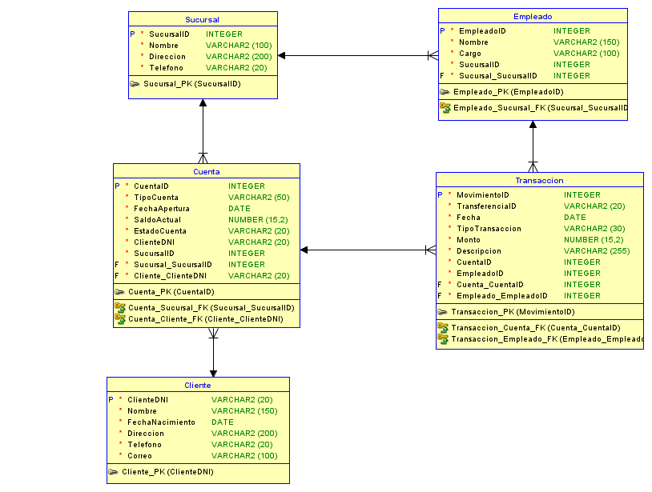
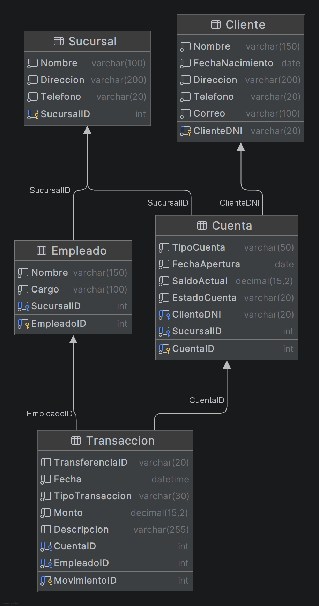

<div align="center">

**Universidad de San Carlos de Guatemala**  
**Facultad de Ingenieria**  
**Sistema de Bases de Datos 2 - P**  

**Grupo - 13**  
**Participantes:**    
**Daniel Estuardo Salvatierra Macajola - 202202768**   
**Daniel Alejandro Castellanos Rodriguez - 202200176**   
**Carlos Fernando Matta Peña - 202302190**   


**Guatemala 10 de Junio 2026**  

</div>

<h1 align="center">Proyecto 1 - Manual Técnico</h1>

## Tabla de Contenidos
1. [Proceso de Normalización](#1-proceso-de-normalización)
2. [Diccionario de Datos](#2-diccionario-de-datos)
3. [Diagrama Entidad-Relación](#3-diagrama-entidad-relación)
4. [Procedimientos Almacenados](#4-procedimientos-almacenados)
5. [Procedimientos de Operaciones Bancarias](#5-procedimientos-de-operaciones-bancarias)
6. [Control de Concurrencia](#6-control-de-concurrencia)
7. [Migración de Datos](#7-migración-de-datos)
8. [Arquitectura de la Solución](#8-arquitectura-de-la-solución)

## 1. Proceso de Normalización

### Documentos analizados

Se dan 5 archivos CSV con información redundante e inconsistente:
- `clientes_raw.csv`
- `cuentas_raw.csv`
- `empleados_raw.csv`
- `sucursales_raw.csv`
- `transacciones_raw.csv`

---

### Primera Forma Normal (1FN)

**Regla:** La regla de la 1FN nos dice que cada celda debe tener un único valor atómico. No puede haber grupos repetidos ni listas dentro de una columna.

**Análisis de los datos crudos:**

Los 5 archivos CSV ya cumplen con 1FN porque cada celda contiene un único valor. No hay columnas con listas separadas por comas ni grupos repetidos.

**Problemas encontrados:**

| Archivo | Problema |
|---|---|
| `cuentas_raw.csv` | La cuenta 1001 aparece 2 veces con saldos distintos (3800.00 y 3500.00) |
| `cuentas_raw.csv` | La cuenta 1003 aparece 2 veces con saldos distintos (3750.00 y 4550.00) |
| `transacciones_raw.csv` | Los movimientos 10/16 y 11/17 son filas duplicadas |
| `sucursales_raw.csv` | La sucursal 1 aparece dos veces con direcciones diferentes |

Estos problemas se resolvieron durante la migración en Python usando `drop_duplicates()` donde lo que se hace es tomar el primer dato que aparece en los archivos y eliminar los otros duplicados. Con este procedimiento se logro pasar los datos dados a la 1FN.

---

### Segunda Forma Normal (2FN)

**Regla:** La regla de la 2FN nos dice que todos los atributos que no son clave deben depender de toda la clave primaria, no solo de una parte. Elimina dependencias parciales. Esto quiero decir que no debemos tener datos innecesarios, todo dato va en su tabla correspondiente.

**Problema encontrado en `cuentas_raw.csv`:**

La tabla tenía esta estructura:

| CuentaID | TipoCuenta | SaldoActual | ClienteDNI | ClienteNombre | ClienteDireccion | ClienteTelefono | SucursalID | SucursalNombre |
|---|---|---|---|---|---|---|---|---|
| 1001 | Ahorro | 3800.00 | 10001 | Jose Morales | Colonia Centro 5-21 | 55510001 | 1 | Centro |
| 1002 | Corriente | 900.00 | 10002 | Maria Lopez | Colonia Jardin 1-10 | 55510002 | 1 | Centro |

`ClienteNombre`, `ClienteDireccion` y `ClienteTelefono` dependen únicamente de `ClienteDNI`, no de `CuentaID`. Esto genera redundancia por ejemplo si Jose Morales cambia de dirección, hay que actualizar todas sus cuentas.

**Problema encontrado en `empleados_raw.csv`:**

`SucursalNombre` y `SucursalDireccion` dependen únicamente de `SucursalID`, no de `EmpleadoID`.

**Solución aplicada:** Se separaron las entidades en tablas independientes:

- `Cliente` — contiene únicamente datos del cliente
- `Sucursal` — contiene únicamente datos de la sucursal
- `Cuenta` — solo mantiene `ClienteDNI` y `SucursalID` como referencias


---

### Tercera Forma Normal (3FN)

**Regla:** La regla de la 3FN nos dice que ningún atributo no-clave debe depender de otro atributo no-clave. Elimina dependencias transitivas. Es casi igual a la 2FN pero ahora nos aseguramos que no haya atributos que dependan de otros atributos que no son clave.

**Problema encontrado en `transacciones_raw.csv`:**

La tabla cruda tenía esta estructura:

| MovimientoID | CuentaID | TipoCuenta | ClienteDNI | EmpleadoID | EmpleadoNombre | EmpleadoCargo | SucursalID | SucursalNombre |
|---|---|---|---|---|---|---|---|---|
| 1 | 1001 | Ahorro | 10001 | 501 | Ana Torres | Cajero | 1 | Centro |

La cadena de dependencias transitivas era:

MovimientoID → EmpleadoID → EmpleadoNombre, EmpleadoCargo  
MovimientoID → EmpleadoID → SucursalID → SucursalNombre  
MovimientoID → CuentaID → TipoCuenta, ClienteDNI

Para saber el nombre del empleado había que pasar primero por `EmpleadoID`, tambien para saber el nombre de la sucursal había que pasar por `EmpleadoID` y luego por `SucursalID`. Eso son dependencias transitivas.

**Solución aplicada:** Se crearon tablas independientes para cada entidad:

- `Empleado` — contiene nombre y cargo, referencia a `Sucursal`
- `Transaccion` — solo mantiene `CuentaID` y `EmpleadoID` como referencias


## 2. Diccionario de Datos

### Tabla: Sucursal

| Columna | Tipo | Restricciones | Descripción |
|---|---|---|---|
| SucursalID | INT | PK, NOT NULL | Identificador único de la sucursal |
| Nombre | VARCHAR(100) | NOT NULL | Nombre de la sucursal |
| Direccion | VARCHAR(200) | NOT NULL | Dirección física de la sucursal |
| Telefono | VARCHAR(20) | NOT NULL | Número de teléfono de la sucursal |

---

### Tabla: Cliente

| Columna | Tipo | Restricciones | Descripción |
|---|---|---|---|
| ClienteDNI | VARCHAR(20) | PK, NOT NULL | Número de identificación único del cliente |
| Nombre | VARCHAR(150) | NOT NULL | Nombre completo del cliente |
| FechaNacimiento | DATE | NOT NULL | Fecha de nacimiento del cliente |
| Direccion | VARCHAR(200) | NOT NULL | Dirección de residencia del cliente |
| Telefono | VARCHAR(20) | NOT NULL | Número de teléfono del cliente |
| Correo | VARCHAR(100) | NOT NULL | Correo electrónico del cliente |

---

### Tabla: Empleado

| Columna | Tipo | Restricciones | Descripción |
|---|---|---|---|
| EmpleadoID | INT | PK, NOT NULL | Identificador único del empleado |
| Nombre | VARCHAR(150) | NOT NULL | Nombre completo del empleado |
| Cargo | VARCHAR(100) | NOT NULL | Puesto del empleado |
| SucursalID | INT | FK → Sucursal, NOT NULL | Sucursal a la que pertenece el empleado |

---

### Tabla: Cuenta

| Columna | Tipo | Restricciones | Descripción |
|---|---|---|---|
| CuentaID | INT | PK, NOT NULL, AUTO_INCREMENT | Identificador único de la cuenta |
| TipoCuenta | VARCHAR(50) | NOT NULL, CHECK (Ahorro, Corriente) | Tipo de cuenta bancaria |
| FechaApertura | DATE | NOT NULL | Fecha en que se abrió la cuenta |
| SaldoActual | DECIMAL(15,2) | NOT NULL, DEFAULT 0.00, CHECK >= 0 | Saldo disponible actual en la cuenta |
| EstadoCuenta | VARCHAR(20) | NOT NULL, DEFAULT ACTIVA, CHECK (ACTIVA, INACTIVA) | Estado actual de la cuenta |
| ClienteDNI | VARCHAR(20) | FK → Cliente, NOT NULL | Cliente propietario de la cuenta |
| SucursalID | INT | FK → Sucursal, NOT NULL | Sucursal donde se abrió la cuenta |

---

### Tabla: Transaccion

| Columna | Tipo | Restricciones | Descripción |
|---|---|---|---|
| MovimientoID | INT | PK, NOT NULL, AUTO_INCREMENT | Identificador único del movimiento |
| TransferenciaID | VARCHAR(20) | NULL | ID que vincula los dos movimientos de una transferencia. NULL para depósitos y retiros |
| Fecha | DATETIME | NOT NULL, DEFAULT CURRENT_TIMESTAMP | Fecha y hora en que ocurrió el movimiento |
| TipoTransaccion | VARCHAR(30) | NOT NULL, CHECK (DEPOSITO, RETIRO, TRANSFERENCIA_SALIDA, TRANSFERENCIA_ENTRADA) | Tipo de operación realizada |
| Monto | DECIMAL(15,2) | NOT NULL, CHECK > 0 | Cantidad de dinero involucrada en el movimiento |
| Descripcion | VARCHAR(255) | NULL | Detalle opcional del movimiento |
| CuentaID | INT | FK → Cuenta, NOT NULL | Cuenta involucrada en el movimiento |
| EmpleadoID | INT | FK → Empleado, NOT NULL | Empleado que procesó el movimiento |

---

### Relaciones entre tablas

| Tabla hijo | Columna FK | Tabla padre | Columna PK |
|---|---|---|---|
| Empleado | SucursalID | Sucursal | SucursalID |
| Cuenta | ClienteDNI | Cliente | ClienteDNI |
| Cuenta | SucursalID | Sucursal | SucursalID |
| Transaccion | CuentaID | Cuenta | CuentaID |
| Transaccion | EmpleadoID | Empleado | EmpleadoID |

## 3. Diagrama Entidad-Relación



### Diagrama de Tablas en DataGrip   


## 4. Procedimientos Almacenados

Como parte de la lógica de negocio del sistema bancario se implementaron nueve procedimientos almacenados. Estos procedimientos permiten realizar operaciones de registro, actualización, consultas y movimientos bancarios manteniendo la integridad de los datos.

### Procedimientos Implementados

| Procedimiento | Descripción |
|-------------|-------------|
| SP_RegistrarCliente | Registra un nuevo cliente en el sistema. |
| SP_ActualizarCliente | Actualiza la información de contacto de un cliente existente. |
| SP_AbrirCuenta | Crea una nueva cuenta bancaria para un cliente existente. |
| SP_RegistrarDeposito | Registra un depósito y actualiza el saldo de la cuenta. |
| SP_RegistrarRetiro | Registra un retiro y descuenta el saldo de la cuenta. |
| SP_RealizarTransferencia | Transfiere fondos entre dos cuentas registrando ambos movimientos. |
| SP_ReporteClientesSucursal | Genera un reporte de clientes por sucursal. |
| SP_CerrarCuenta | Permite cerrar una cuenta únicamente si su saldo es cero. |
| SP_ReporteMovimientosCuenta | Consulta movimientos de una cuenta por rango de fechas. |

## 5. Procedimientos de Operaciones Bancarias

Los procedimientos desarrollados para las operaciones bancarias fueron implementados utilizando transacciones para garantizar la atomicidad y consistencia de los datos.

Todos los procedimientos utilizan:

- START TRANSACTION
- COMMIT
- ROLLBACK

Además se implementaron bloqueos mediante SELECT ... FOR UPDATE para evitar inconsistencias por acceso concurrente.

### SP_RegistrarDeposito

Permite registrar depósitos en cuentas bancarias activas.

#### Validaciones implementadas

- La cuenta debe existir.
- La cuenta debe estar activa.
- El empleado debe existir.
- El monto debe ser mayor a cero.

#### Operaciones realizadas

1. Bloqueo de la cuenta mediante FOR UPDATE.
2. Registro del movimiento en la tabla Transaccion.
3. Actualización del saldo de la cuenta.
4. Confirmación de la transacción mediante COMMIT.

#### Manejo de errores

Si ocurre cualquier error durante la operación se ejecuta ROLLBACK para mantener la consistencia de los datos.

### SP_RegistrarRetiro

Permite retirar dinero de una cuenta bancaria.

#### Validaciones implementadas

- La cuenta debe existir.
- La cuenta debe estar activa.
- El empleado debe existir.
- El monto debe ser mayor a cero.
- El saldo disponible debe ser suficiente.

#### Operaciones realizadas

1. Bloqueo de la cuenta mediante FOR UPDATE.
2. Registro del movimiento en la tabla Transaccion.
3. Descuento del monto solicitado.
4. Confirmación mediante COMMIT.

#### Manejo de errores

Cuando el saldo es insuficiente o ocurre un error interno se ejecuta ROLLBACK.

### SP_RealizarTransferencia

Permite transferir fondos entre dos cuentas bancarias.

#### Validaciones implementadas

- La cuenta origen debe existir.
- La cuenta destino debe existir.
- Ambas cuentas deben estar activas.
- El monto debe ser mayor a cero.
- La cuenta origen debe tener saldo suficiente.
- La cuenta origen y destino no pueden ser la misma.

#### Operaciones realizadas

1. Bloqueo de ambas cuentas utilizando FOR UPDATE.
2. Descuento del monto en la cuenta origen.
3. Incremento del monto en la cuenta destino.
4. Registro de TRANSFERENCIA_SALIDA.
5. Registro de TRANSFERENCIA_ENTRADA.
6. Confirmación mediante COMMIT.

#### Manejo de errores

Si cualquier operación falla se ejecuta ROLLBACK para revertir completamente la transferencia.

## 6. Control de Concurrencia

Para garantizar la consistencia de los datos se realizaron pruebas de concurrencia utilizando múltiples sesiones activas de MySQL.

### Objetivo

Evitar que dos usuarios modifiquen simultáneamente el saldo de una misma cuenta provocando inconsistencias.

### Prueba realizada

### Sesión 1

```sql
START TRANSACTION;

SELECT *
FROM Cuenta
WHERE CuentaID = 1001
FOR UPDATE;
```

### Sesión 2
```sql
CALL SP_RegistrarRetiro(
    1001,
    50.00,
    'Prueba concurrencia',
    501
);
```

---

## 7. Migración de Datos

La migración de datos fue desarrollada utilizando Python y la librería Pandas.

### Archivos fuente

- clientes_raw.csv
- cuentas_raw.csv
- empleados_raw.csv
- sucursales_raw.csv
- transacciones_raw.csv

### Proceso realizado

1. Lectura de archivos CSV.
2. Eliminación de registros duplicados.
3. Limpieza de datos inconsistentes.
4. Transformación de formatos.
5. Inserción de registros en las tablas normalizadas.

### Herramientas utilizadas

- Python 3
- Pandas
- mysql-connector-python

## 8. Arquitectura de la Solución

El proyecto fue implementado utilizando una arquitectura basada en contenedores Docker.

### Componentes

#### Base de Datos

- MySQL 8.0

#### Migración

- Python
- Pandas

#### Administración

- DataGrip

#### Control de Versiones

- Git
- GitHub

#### Contenedor

- Docker Compose
**