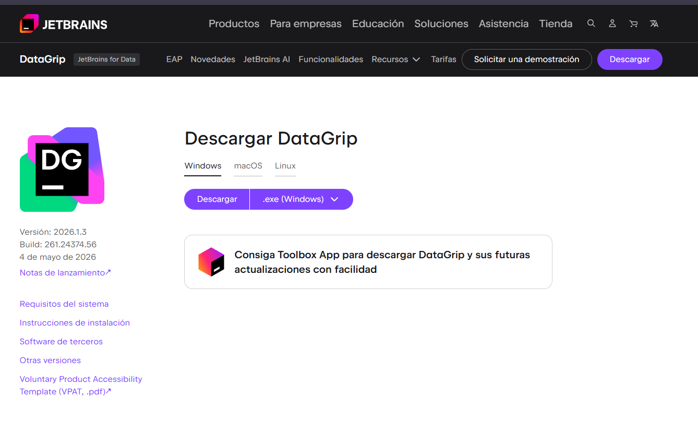
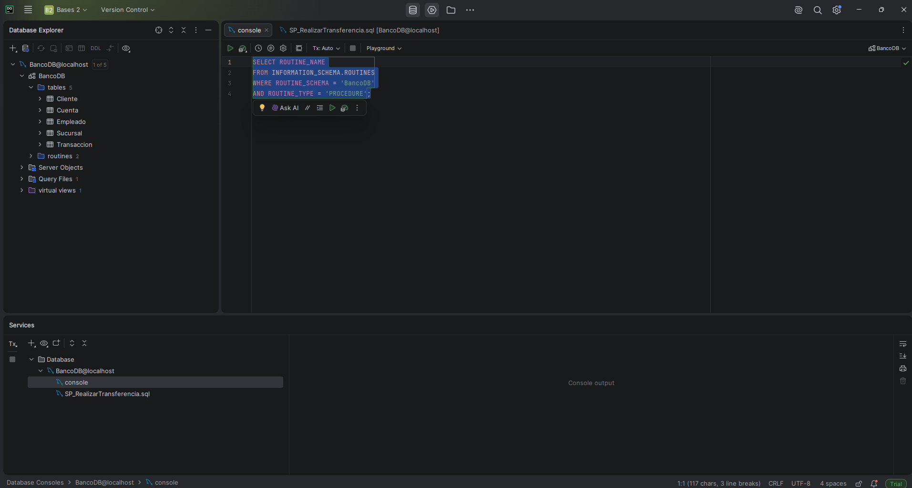
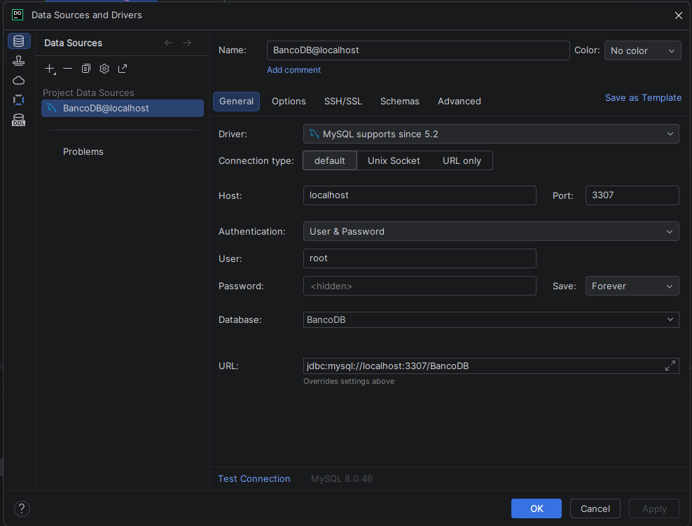
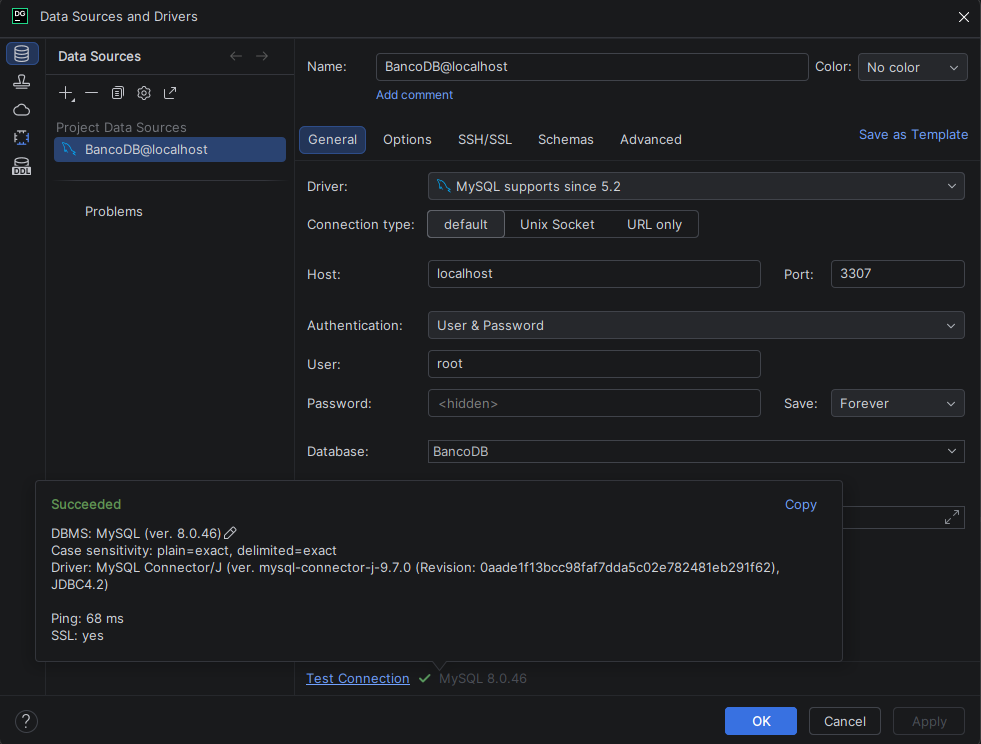
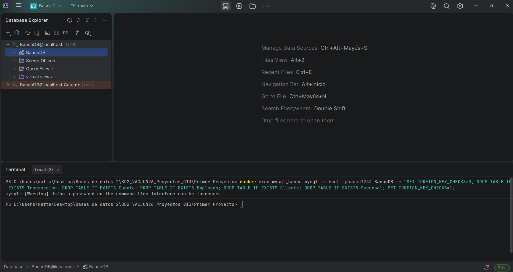
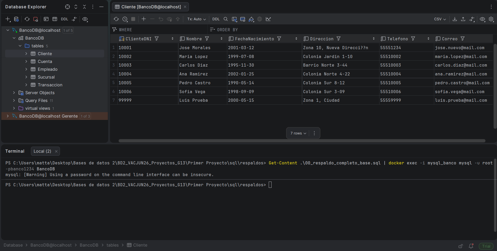
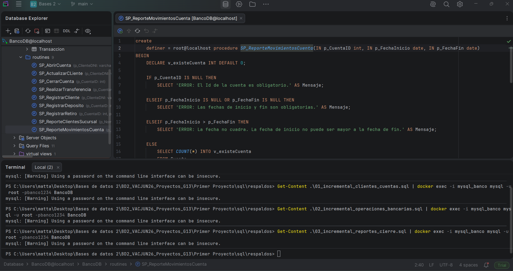

<div align="center">

**Universidad de San Carlos de Guatemala**  
**Facultad de Ingenieria**  
**Sistema de Bases de Datos 2 - P**  

**Grupo - 13**  
**Participantes:**    
**Daniel Estuardo Salvatierra Macajola - 202202768**   
**Daniel Alejandro Castellanos Rodriguez - 202200176**   
**Carlos Fernando Matta Peña - 202302190**   


**Guatemala 10 de Junio 2026**  

</div>

<h1 align="center">Proyecto 1 - Manual de Usuario</h1>

## Índice

1. [Instrucciones para la Ejecución del Proyecto](#1-instrucciones-para-la-ejecución-del-proyecto)
2. [Instalación de DataGrip y conexión a la base de datos](#2-instalación-de-datagrip-y-conexión-a-la-base-de-datos)
3. [Ejecución de Procedimientos Almacenados](#3-ejecución-de-procedimientos-almacenados)
4. [Validación de Resultados](#4-validación-de-resultados)
5. [Pruebas de Concurrencia](#5-pruebas-de-concurrencia)
6. [Respaldos y Recuperación](#6-respaldos-y-recuperación)
7. [Arquitectura de la Solución](#7-arquitectura-de-la-solución)

## 1. Instrucciones para la Ejecución del Proyecto 

### 1.1. Levantar la base de datos con Docker

```bash
cd Primer Proyecto
docker compose up -d
```

### 1.2. Crear las tablas

```bash
docker exec -i mysql_banco mysql -u root -pbanco1234 BancoDB < sql/ddl/01_crear_tablas.sql
```

O

```powershell
Get-Content .\sql\ddl\01_crear_tablas.sql | docker exec -i mysql_banco mysql -u root -pbanco1234 BancoDB
```

Para validar que las tablas se hayan creado correctamente, puedes ejecutar el siguiente comando:

```bash
docker exec -it mysql_banco mysql -u root -pbanco1234 BancoDB
```

dentro del cliente de MySQL, puedes listar las tablas con:
```sql
SHOW TABLES;
exit;
```


### 1.3. Crear entorno virtual e instalar dependencias

```bash
pip install -r requirements.txt
```

### 1.4. Migración de datos

```bash
python migrar_datos.py
```

## 2. Instalación de DataGrip y conexión a la base de datos

### 2.1. Descargar DataGrip

1. Ingresar al sitio oficial de JetBrains: https://www.jetbrains.com/datagrip/
2. Descargar la version correspondiente al sistema operativo.
3. Ejecutar el instalador y completar el proceso de instalacion con las opciones predeterminadas.



### 2.2. Abrir DataGrip por primera vez

1. Iniciar DataGrip desde el menu de aplicaciones.
2. Aceptar los terminos de uso o iniciar sesion con una cuenta de JetBrains si el asistente lo solicita.
3. Esperar a que se cargue la ventana principal del programa.



### 2.3. Crear una nueva conexión

1. En la pantalla inicial, seleccionar **New Data Source**.
2. Elegir **MySQL** como tipo de base de datos.
3. Si aparece el aviso para descargar el driver, permitir la descarga para continuar.



### 2.4. Configurar los datos de conexión

En la pestaña **General** ingresar los siguientes datos:

- **Host:** localhost
- **Puerto:** 3307
- **Usuario:** root
- **Contrasena:** banco1234
- **Base de datos:** BancoDB

### 2.5. Probar y guardar la conexión

1. Presionar **Test Connection** para verificar que DataGrip puede conectarse al contenedor de MySQL.
2. Si la prueba es correcta, seleccionar **Apply** y luego **OK**.
3. La base de datos **BancoDB** quedara disponible en el panel lateral para ejecutar consultas.


### 2.6. Resultado esperado

Al finalizar estos pasos, DataGrip debe mostrar la conexion activa hacia MySQL y permitir consultar las tablas creadas por el proyecto.

## 3. Ejecución de Procedimientos Almacenados

Una vez establecida la conexión con la base de datos desde DataGrip, es posible crear y ejecutar los procedimientos almacenados del proyecto.

### 3.1. Ejecutar procedimientos desde DataGrip

1. Abrir el archivo SQL correspondiente al procedimiento almacenado.
2. Seleccionar todo el contenido del archivo con `Ctrl + A`.
3. Ejecutar el script con `Ctrl + Enter` o presionando el botón de ejecución ubicado en la barra superior.

Ejemplo:

```text
sql/procedimientos/SP_RegistrarDeposito.sql
```

DataGrip enviará automáticamente el script al servidor MySQL y creará el procedimiento almacenado.

#### Verificar que el procedimiento fue creado

1. Refrescar la conexión en DataGrip.
2. Abrir el esquema `BancoDB`.
3. Revisar la carpeta `routines`, donde aparecerán los procedimientos almacenados.

También es posible verificarlo mediante una consulta SQL:

```sql
SHOW PROCEDURE STATUS
WHERE Db = 'BancoDB';

SELECT ROUTINE_NAME
FROM INFORMATION_SCHEMA.ROUTINES
WHERE ROUTINE_SCHEMA = 'BancoDB'
AND ROUTINE_TYPE = 'PROCEDURE';
```

### 3.2. Ejecutar procedimientos desde Docker y PowerShell

También es posible crear procedimientos almacenados utilizando la terminal de PowerShell.

Ejemplo:

```powershell
Get-Content .\sql\procedimientos\SP_RegistrarDeposito.sql | docker exec -i mysql_banco mysql -u root -pbanco1234 BancoDB
```

De igual manera para cualquier otro procedimiento:

```powershell
Get-Content .\sql\procedimientos\SP_RegistrarRetiro.sql | docker exec -i mysql_banco mysql -u root -pbanco1234 BancoDB
Get-Content .\sql\procedimientos\SP_RealizarTransferencia.sql | docker exec -i mysql_banco mysql -u root -pbanco1234 BancoDB
```

### 3.3. Ejemplos de ejecución

Los procedimientos almacenados pueden ejecutarse desde la consola SQL de DataGrip.

```sql
CALL SP_RegistrarDeposito(
    1001,
    100.00,
    'Deposito de prueba',
    501
);

CALL SP_RegistrarRetiro(
    1001,
    50.00,
    'Retiro de prueba',
    501
);

CALL SP_RealizarTransferencia(
    1001,
    1002,
    25.00
);
```

## 4. Validación de Resultados

Para verificar que las operaciones fueron ejecutadas correctamente se pueden realizar las siguientes consultas.

### 4.1. Consultar saldo de una cuenta

```sql
SELECT CuentaID, SaldoActual
FROM Cuenta
WHERE CuentaID = 1001;
```

### 4.2. Consultar movimientos registrados

```sql
SELECT
    MovimientoID,
    TipoTransaccion,
    Monto,
    CuentaID,
    EmpleadoID,
    Fecha
FROM Transaccion
ORDER BY MovimientoID DESC;
```

### 4.3. Consultar todas las cuentas

```sql
SELECT *
FROM Cuenta;
```

### 4.4. Consultar todos los clientes

```sql
SELECT *
FROM Cliente;
```

### 4.5. Consultar todos los empleados

```sql
SELECT *
FROM Empleado;
```

## 5. Pruebas de Concurrencia

El proyecto incluye validación de concurrencia mediante el uso de múltiples sesiones activas.

### 5.1. Sesión 1

```sql
START TRANSACTION;

SELECT *
FROM Cuenta
WHERE CuentaID = 1001
FOR UPDATE;
```

La cuenta quedará bloqueada mientras la transacción permanezca abierta.

### 5.2. Sesión 2

```sql
CALL SP_RegistrarRetiro(
    1001,
    50.00,
    'Prueba concurrencia',
    501
);
```

La ejecución permanecerá en espera hasta que la primera sesión libere el bloqueo.

### 5.3. Liberar bloqueo

En la sesión 1 ejecutar:

```sql
COMMIT;
```

Una vez realizado el `COMMIT`, la segunda sesión continuará su ejecución normalmente.

### 5.4. Resultado esperado

Al finalizar estos pasos, DataGrip debe mostrar la conexión activa hacia MySQL y permitir consultar las tablas creadas por el proyecto.

Esta prueba demuestra el correcto funcionamiento de las transacciones y los mecanismos de control de concurrencia implementados mediante bloqueos de fila (`FOR UPDATE`) en MySQL.


## 6. Respaldos y Recuperación

Primer Proyecto - Sistemas de Bases de Datos 2  
Base de datos: `BancoDB`  
DBMS: MySQL  
Contenedor Docker: `mysql_banco`

---

### 6.1. Objetivo


Este documento describe el procedimiento de respaldos utilizado para el proyecto, así como el proceso de recuperación de la base de datos a partir de un respaldo completo y tres respaldos incrementales.


El procedimiento utilizado consiste en:

1. Un respaldo completo de la base de datos funcional, unicamente tablas y datos
2. Tres respaldos incrementales que contienen los procedimientos almacenados agregados posteriormente.

---

### 6.2. Archivos de respaldo

Los archivos se encuentran en la carpeta:

```text
sql/respaldos/
```

La estructura es la siguiente:

```text
sql/respaldos/
├── 00_respaldo_completo_base.sql
├── 01_incremental_clientes_cuentas.sql
├── 02_incremental_operaciones_bancarias.sql
├── 03_incremental_reportes_cierre.sql
└── README_respaldos.md
```

---

### 6.3. Respaldo completo

```text
sql/respaldos/
```

El archivo contiene:

- Estructura de tablas.
- Llaves primarias.
- Llaves foráneas.
- Restricciones.
- Datos cargados en la base.

No contiene procedimientos almacenados.

Este respaldo fue generado con el comando:

```bash
docker exec mysql_banco mysqldump -u root -pbanco1234 --set-gtid-purged=OFF BancoDB > 00_respaldo_completo_base.sql
```
---

### 6.4. Respaldos incrementales

Los respaldos incrementales contienen únicamente cambios posteriores al respaldo completo. En este proyecto, dichos cambios corresponden a procedimientos almacenados.

#### Incremental 01

Archivo:
```text
01_incremental_clientes_cuentas.sql
```

Contiene:

- `SP_RegistrarCliente`
- `SP_ActualizarCliente`
- `SP_AbrirCuenta`

#### Incremental 02

Archivo:
```text
02_incremental_operaciones_bancarias.sql
```

Contiene:

- `SP_RegistrarDeposito`
- `SP_RegistrarRetiro`
- `SP_RealizarTransferencia`

#### Incremental 03

Archivo:
```text
03_incremental_reportes_cierre.sql
```

Contiene:

- `SP_CerrarCuenta`
- `SP_ReporteClientesSucursal`
- `SP_ReporteMovimientosCuenta`

### 6.5. Recuperación

1. Primero borramos todos los contenidos de nuestra base, es decir borramos todas nuestras tablas:

```bash
docker exec mysql_banco mysql -u root -pbanco1234 BancoDB -e "SET FOREIGN_KEY_CHECKS=0; DROP TABLE IF EXISTS Transaccion; DROP TABLE IF EXISTS Cuenta; DROP TABLE IF EXISTS Empleado; DROP TABLE IF EXISTS Cliente; DROP TABLE IF EXISTS Sucursal; SET FOREIGN_KEY_CHECKS=1;"
```


2. Luego se restaura el respaldo completo:

```bash
Get-Content .\00_respaldo_completo_base.sql | docker exec -i mysql_banco mysql -u root -pbanco1234 BancoDB
```


3. Después se aplican los incrementales:

```bash
Get-Content .\01_incremental_clientes_cuentas.sql | docker exec -i mysql_banco mysql -u root -pbanco1234 BancoDB
```

```bash
Get-Content .\02_incremental_operaciones_bancarias.sql | docker exec -i mysql_banco mysql -u root -pbanco1234 BancoDB
```

```bash
Get-Content .\03_incremental_reportes_cierre.sql | docker exec -i mysql_banco mysql -u root -pbanco1234 BancoDB
```



### 6.6. Verificación de recuperación

Después de restaurar la base y aplicar los incrementales, se recomienda ejecutar:

```SQL
USE BancoDB;

SHOW TABLES;
```

Resultado esperado:

| Tables\_in\_BancoDB |
| :--- |
| Cliente |
| Cuenta |
| Empleado |
| Sucursal |
| Transaccion |

Verificar procedimientos:
```SQL
SHOW PROCEDURE STATUS
WHERE Db = 'BancoDB';
```

Deben aparecer los nueve procedimientos:

| Db | Name | Type | Definer | Modified | Created | Security\_type | Comment | character\_set\_client | collation\_connection | Database Collation |
| :--- | :--- | :--- | :--- | :--- | :--- | :--- | :--- | :--- | :--- | :--- |
| BancoDB | SP\_AbrirCuenta | PROCEDURE | root@localhost | 2026-06-09 19:33:01 | 2026-06-09 19:33:01 | DEFINER |  | latin1 | latin1\_swedish\_ci | utf8mb4\_unicode\_ci |
| BancoDB | SP\_ActualizarCLiente | PROCEDURE | root@localhost | 2026-06-09 19:33:01 | 2026-06-09 19:33:01 | DEFINER |  | latin1 | latin1\_swedish\_ci | utf8mb4\_unicode\_ci |
| BancoDB | SP\_CerrarCuenta | PROCEDURE | root@localhost | 2026-06-09 19:33:15 | 2026-06-09 19:33:15 | DEFINER |  | latin1 | latin1\_swedish\_ci | utf8mb4\_unicode\_ci |
| BancoDB | SP\_RealizarTransferencia | PROCEDURE | root@localhost | 2026-06-09 19:33:10 | 2026-06-09 19:33:10 | DEFINER |  | latin1 | latin1\_swedish\_ci | utf8mb4\_unicode\_ci |
| BancoDB | SP\_RegistrarCliente | PROCEDURE | root@localhost | 2026-06-09 19:33:01 | 2026-06-09 19:33:01 | DEFINER |  | latin1 | latin1\_swedish\_ci | utf8mb4\_unicode\_ci |
| BancoDB | SP\_RegistrarDeposito | PROCEDURE | root@localhost | 2026-06-09 19:33:10 | 2026-06-09 19:33:10 | DEFINER |  | latin1 | latin1\_swedish\_ci | utf8mb4\_unicode\_ci |
| BancoDB | SP\_RegistrarRetiro | PROCEDURE | root@localhost | 2026-06-09 19:33:10 | 2026-06-09 19:33:10 | DEFINER |  | latin1 | latin1\_swedish\_ci | utf8mb4\_unicode\_ci |
| BancoDB | SP\_ReporteClientesSucursal | PROCEDURE | root@localhost | 2026-06-09 19:33:15 | 2026-06-09 19:33:15 | DEFINER |  | latin1 | latin1\_swedish\_ci | utf8mb4\_unicode\_ci |
| BancoDB | SP\_ReporteMovimientosCuenta | PROCEDURE | root@localhost | 2026-06-09 19:33:15 | 2026-06-09 19:33:15 | DEFINER |  | latin1 | latin1\_swedish\_ci | utf8mb4\_unicode\_ci |


### 6.7. Observaciones
- El respaldo completo no incluye procedimientos almacenados.
- Los procedimientos se recuperan mediante los tres respaldos incrementales.
- Los incrementales deben ejecutarse en orden.
- Si se modifica un procedimiento, debe actualizarse también el incremental correspondiente.
- Los mensajes de advertencia sobre uso de contraseña en línea de comandos no afectan la ejecución en este entorno académico.


## 7. Arquitectura de la Solución

El proyecto fue implementado utilizando una arquitectura basada en contenedores Docker.

### Componentes

#### Base de Datos

- MySQL 8.0

#### Migración

- Python
- Pandas

#### Administración

- DataGrip

#### Control de Versiones

- Git
- GitHub

#### Contenedor

- Docker Compose
