<div align="center">

**Universidad de San Carlos de Guatemala**  
**Facultad de Ingenieria**  
**Sistema de Bases de Datos 2 - P**  

**Grupo - 13**  
**Participantes:**    
**Daniel Estuardo Salvatierra Macajola - 202202768**   
**Daniel Alejandro Castellanos Rodriguez - 202200176**   
**Carlos Fernando Matta Peña - 202302190**   


**Guatemala 22 de Junio 2026**  

</div>

<h1 align="center">Proyecto 2 - Manual Técnico</h1>

## Tabla de Contenidos
1. [Diseño lógico del modelo de grafos](#1-diseño-lógico-del-modelo-de-grafos)  
   1.1 [Identificación de entidades](#11-identificación-de-entidades)  
   1.2 [Nodos con sus propiedades y tipos de dato](#12-nodos-con-sus-propiedades-y-tipos-de-dato)  
   1.3 [Identificadores únicos — formato y justificación](#13-identificadores-únicos--formato-y-justificación)  
   1.4 [Relaciones con dirección y propiedades](#14-relaciones-con-dirección-y-propiedades)  
2. [Reglas de negocio reflejadas en el modelo](#2-reglas-de-negocio-reflejadas-en-el-modelo) 
3. [Imagen de grafo de ejemplo](#3-imagen-de-grafo-de-ejemplo)   
4. [Consultas Cypher desarrolladas](#4-consultas-cypher-desarrolladas)  
   4.1 [Consulta 5: Restaurantes sin visitas en los últimos N días](#41-consulta-5-restaurantes-sin-visitas-en-los-últimos-n-días)         
   4.2 [Consulta 8: Crecimiento de visitas por tipo de cocina entre dos periodos](#42-consulta-8-crecimiento-de-visitas-por-tipo-de-cocina-entre-dos-periodos)          
   4.3 [Consulta 9: Recomendación de restaurantes a un usuario](#43-consulta-9-recomendación-de-restaurantes-a-un-usuario)      
5. [Análisis de red](#5-análisis-de-red)   
   5.1 [Ruta más corta entre usuarios](#51-ruta-más-corta-entre-usuarios)
6. [Aporte del Integrante 3](#6-aporte-del-integrante-3) 

## 1. Diseño lógico del modelo de grafos

### 1.1 Identificación de entidades
El primer paso del diseño fue identificar qué entidades del mundo real se convierten en nodos del grafo. La regla general es: si la entidad tiene identidad propia y atributos propios, es un nodo. Si solo representa una conexión entre dos entidades, es una relación.

Las entidades identificadas fueron:  
- Usuario — persona que utiliza la plataforma y genera interacciones.  
- Restaurante — establecimiento gastronómico registrado en el sistema.  
- TipoCocina — categoría gastronómica que clasifica restaurantes.  
- Chef — profesional culinario vinculado a restaurantes y platillos.  
- Platillo — preparación culinaria ofrecida por los restaurantes.  

### 1.2 Nodos con sus propiedades y tipos de dato
 
#### Usuario
| Propiedad | Tipo | Notas |
|---|---|---|
| id_usuario | String | Identificador único con prefijo `U` |
| nombre | String | Nombre completo |
| email | String | Único en todo el sistema |
| edad | Integer | Edad en años |
| pais | String | País de residencia |
 
#### Restaurante
| Propiedad | Tipo | Notas |
|---|---|---|
| id_restaurante | String | Identificador único con prefijo `R` |
| nombre | String | Nombre del establecimiento |
| anio_apertura | Integer | Año de apertura del local |
| rango_precios | String | Valores: `$`, `$$`, `$$$` |
| descripcion | String | Descripción breve del restaurante |
 
#### TipoCocina
| Propiedad | Tipo | Notas |
|---|---|---|
| id_tipo_cocina | String | Identificador único con prefijo `T` |
| nombre | String | Único — no puede haber dos tipos iguales |
| descripcion | String | Descripción de la categoría |
 
#### Chef
| Propiedad | Tipo | Notas |
|---|---|---|
| id_chef | String | Identificador único con prefijo `C` |
| nombre | String | Nombre completo del chef |
| fecha_nacimiento | Date | Formato `YYYY-MM-DD` |
| nacionalidad | String | País de origen |
 
#### Platillo
| Propiedad | Tipo | Notas |
|---|---|---|
| id_platillo | String | Identificador único con prefijo `P` |
| nombre | String | Nombre del platillo |
| precio | Float | Precio de referencia o catálogo |
| descripcion | String | Descripción de la preparación |

### 1.3 Identificadores únicos — formato y justificación
 
Se decidió usar strings con prefijo alfabético y número de 4 dígitos (`U0001`, `R0001`, etc.) en lugar de enteros simples o UUIDs, por las siguientes razones:
 
- **Legibilidad inmediata**: al revisar resultados o archivos CSV, el prefijo indica de qué tipo de entidad se trata sin necesidad de contexto adicional.
- **Facilidad de generación**: el Integrante 2 puede generarlos con un simple loop (`f"U{i:04d}"`) en Python, sin librerías externas.
- **Coherencia entre archivos**: todos los CSV de relaciones referencian los mismos IDs, reduciendo errores de integración.
- **Sin colisiones entre tipos**: `U0001` y `R0001` son distintos aunque compartan el número, lo que evita confusiones.

Ejemplos de identificadores utilizados:

- id_usuario: 1, 2, 3, ...
- id_restaurante: 1, 2, 3, ...
- id_tipo_cocina: 1, 2, 3, ...
- id_chef: 1, 2, 3, ...
- id_platillo: 1, 2, 3, ...

### 1.4 Relaciones con dirección y propiedades
 
La dirección de cada relación se definió siguiendo el principio de **quién origina la acción**. La entidad que "hace" algo apunta hacia la entidad que "recibe" la acción.
 
| Relación | Dirección | Propiedades | Descripción |
|---|---|---|---|
| CALIFICÓ | (Usuario)→(Restaurante) | puntuacion `[1-5]`, fecha, comentario | Un usuario emite una calificación hacia un restaurante |
| VISITÓ | (Usuario)→(Restaurante) | fecha_visita, consumo, con_reserva | Un usuario realiza una visita a un restaurante |
| ES_AMIGO_DE | (Usuario)→(Usuario) | fecha_amistad | Relación de amistad entre dos usuarios |
| LE_GUSTA | (Usuario)→(TipoCocina) | nivel_interes `[1-5]` | Un usuario declara preferencia por un tipo de cocina |
| PERTENECE_A | (Restaurante)→(TipoCocina) | — | Un restaurante se clasifica dentro de un tipo de cocina |
| OFRECE | (Restaurante)→(Platillo) | precio, disponible | Un restaurante ofrece un platillo a un precio específico |
| PREPARA | (Chef)→(Platillo) | estilo, especialidad | Un chef tiene la habilidad de preparar un platillo |
| TRABAJA_EN | (Chef)→(Restaurante) | fecha_inicio, puesto | Un chef está vinculado laboralmente a un restaurante |
 
---

## 2. Reglas de negocio reflejadas en el modelo
 
Las reglas definidas para el sistema son las siguientes:
 
| Regla de negocio | Cómo se refleja en el modelo |
|---|---|
| Un usuario puede calificar múltiples restaurantes | Múltiples relaciones `CALIFICÓ` desde un mismo nodo `Usuario` |
| Las calificaciones deben estar entre 1 y 5 | Propiedad `puntuacion` en `CALIFICÓ`; validada en carga de datos |
| Un restaurante puede pertenecer a varios tipos de cocina | Múltiples relaciones `PERTENECE_A` desde un mismo `Restaurante` |
| Un restaurante no puede ofrecer el mismo platillo más de una vez | Constraint implícito: solo puede existir una relación `OFRECE` entre el mismo par `(Restaurante, Platillo)` |
| Un chef puede trabajar en varios restaurantes | Múltiples relaciones `TRABAJA_EN` desde un mismo `Chef` |
| El sistema recomienda basándose en chefs compartidos | La consulta de recomendación recorre el camino `(Usuario)-[:CALIFICÓ]->(Restaurante)<-[:TRABAJA_EN]-(Chef)-[:TRABAJA_EN]->(otroRestaurante)` |
 
---

## 3. Imagen de grafo de ejemplo  
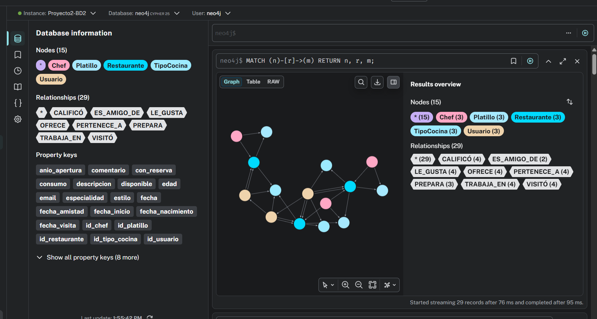


## 4. Carga masiva de datos

La carga masiva de datos se realizó mediante archivos CSV y scripts Cypher utilizando la instrucción `LOAD CSV WITH HEADERS`. Para la generación de datos se utilizó un script en Python llamado `generar_datos.py`, ubicado dentro de la carpeta `scripts`.

Los archivos CSV generados fueron almacenados en la carpeta `data` del proyecto y posteriormente copiados al directorio `import` de Neo4j para permitir su lectura desde Cypher.

### 4.1 Archivos CSV utilizados

| Archivo | Descripción |
|---|---|
| usuarios.csv | Contiene los usuarios del sistema |
| restaurantes.csv | Contiene los restaurantes registrados |
| chefs.csv | Contiene los chefs del sistema |
| platillos.csv | Contiene los platillos disponibles |
| tipos_cocina.csv | Contiene las categorías gastronómicas |
| califico.csv | Relaciones de calificación entre usuarios y restaurantes |
| visito.csv | Relaciones de visita entre usuarios y restaurantes |
| amistades.csv | Relaciones de amistad entre usuarios |
| pertenece_a.csv | Relación entre restaurantes y tipos de cocina |
| ofrece.csv | Relación entre restaurantes y platillos |
| prepara.csv | Relación entre chefs y platillos |
| trabaja_en.csv | Relación entre chefs y restaurantes |
| le_gusta.csv | Relación entre usuarios y tipos de cocina |

### 4.2 Cantidades cargadas

| Elemento | Cantidad |
|---|---:|
| Usuarios | 500 |
| Restaurantes | 200 |
| Chefs | 100 |
| Platillos | 50 |
| Tipos de cocina | 15 |
| VISITÓ | 1600 |
| CALIFICÓ | 1200 |
| ES_AMIGO_DE | 900 |
| PERTENECE_A | 350 |
| OFRECE | 800 |
| PREPARA | 350 |
| TRABAJA_EN | 250 |
| LE_GUSTA | 1000 |

### 4.3 Proceso de carga

Primero se cargaron los nodos principales del grafo mediante el archivo `04_load_nodes.cypher`. Posteriormente se cargaron las relaciones mediante el archivo `05_load_relationships.cypher`.

La carga de nodos utiliza `MERGE` para evitar duplicados y `SET` para asignar las propiedades correspondientes.

Ejemplo:

```cypher
LOAD CSV WITH HEADERS
FROM 'file:///usuarios.csv' AS row
MERGE (u:Usuario {id_usuario: toInteger(row.id_usuario)})
SET
    u.nombre = row.nombre,
    u.email = row.email,
    u.edad = toInteger(row.edad),
    u.pais = row.pais;
```
La carga de relaciones utiliza MATCH para localizar los nodos existentes y luego MERGE o CREATE para crear la relación correspondiente.

Ejemplo:

```cypher
LOAD CSV WITH HEADERS
FROM 'file:///visito.csv' AS row
MATCH (u:Usuario {id_usuario: toInteger(row.id_usuario)})
MATCH (r:Restaurante {id_restaurante: toInteger(row.id_restaurante)})
CREATE (u)-[v:VISITÓ]->(r)
SET
    v.fecha_visita = date(row.fecha_visita),
    v.consumo = toFloat(row.consumo),
    v.con_reserva = toBoolean(row.con_reserva);
```
### 4.4 Validación de carga

```cypher
LOAD CSV WITH HEADERS
FROM 'file:///visito.csv' AS row
MATCH (u:Usuario {id_usuario: toInteger(row.id_usuario)})
MATCH (r:Restaurante {id_restaurante: toInteger(row.id_restaurante)})
CREATE (u)-[v:VISITÓ]->(r)
SET
    v.fecha_visita = date(row.fecha_visita),
    v.consumo = toFloat(row.consumo),
    v.con_reserva = toBoolean(row.con_reserva);
```

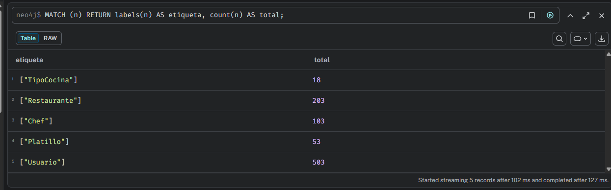

```cypher
MATCH ()-[r]->()
RETURN type(r) AS relacion, count(r) AS total
ORDER BY total DESC;
```

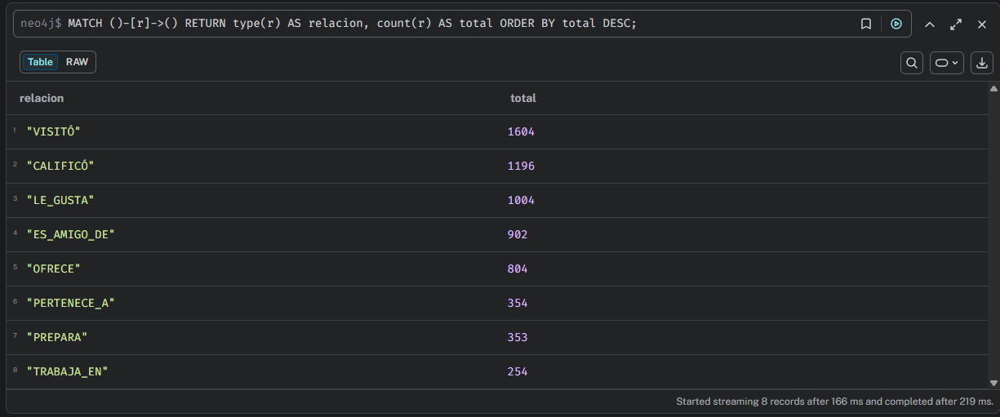

## 5. Consultas Cypher desarrolladas

En esta sección se documentan las consultas Cypher implementadas para el sistema de recomendación de restaurantes en Neo4j. Estas consultas permiten analizar diversidad gastronómica, visitas, reservas, gasto promedio, actividad de restaurantes, movilidad de chefs, variación de precios, crecimiento por tipo de cocina y recomendaciones personalizadas.

Las consultas desarrolladas fueron:

| No. | Consulta | Responsable |
| --- | --- | --- |
| 1 | Diversidad de tipos de cocina por restaurante | Integrante 1 |
| 2 | Tasa de reservas por restaurante | Integrante 2 |
| 3 | Usuarios con mayor gasto promedio por visita | Integrante 2 |
| 4 | Usuarios con mayor frecuencia de visitas en un periodo | Integrante 2 |
| 5 | Restaurantes sin visitas en los últimos N días | Integrante 3 |
| 6 | Chefs con mayor movilidad laboral | Integrante 1 |
| 7 | Platillos con mayor variación de precio entre restaurantes | Integrante 1 |
| 8 | Crecimiento de visitas por tipo de cocina entre dos periodos | Integrante 3 |
| 9 | Recomendación de restaurantes a un usuario | Integrante 3 |

---

### 5.1 Consulta 1: Diversidad de tipos de cocina por restaurante

#### Objetivo

Medir la diversidad gastronómica de cada restaurante a partir de la cantidad de tipos de cocina asociados. Esta consulta permite identificar qué restaurantes ofrecen una propuesta culinaria más variada dentro del sistema.

#### Entidades involucradas

| Entidad | Descripción |
| --- | --- |
| `Restaurante` | Establecimiento gastronómico registrado en la plataforma. |
| `TipoCocina` | Categoría gastronómica a la que puede pertenecer un restaurante. |

#### Relaciones involucradas

| Relación | Descripción |
| --- | --- |
| `PERTENECE_A` | Relación que conecta un restaurante con uno o varios tipos de cocina. |

#### Parámetros utilizados

No utiliza parámetros externos.

#### Código Cypher

```cypher
// Consulta 1: Diversidad de tipos de cocina por restaurante

MATCH (r:Restaurante)-[:PERTENECE_A]->(t:TipoCocina)
RETURN
    r.id_restaurante AS id_restaurante,
    r.nombre AS restaurante,
    r.rango_precios AS precio,
    count(t) AS total_tipos_cocina,
    collect(t.nombre) AS tipos_cocina
ORDER BY total_tipos_cocina DESC;
```

#### Explicación

La consulta busca todos los restaurantes que poseen una relación `PERTENECE_A` con algún nodo `TipoCocina`. Luego agrupa los resultados por restaurante, cuenta cuántos tipos de cocina tiene asociados y reúne los nombres de dichos tipos en una lista.

#### Resultado esperado

Se espera obtener una tabla con los restaurantes, su rango de precios, la cantidad de tipos de cocina asociados y el listado de dichas categorías gastronómicas.

#### Interpretación

Los restaurantes con mayor cantidad de tipos de cocina pueden considerarse más diversos, ya que ofrecen una propuesta gastronómica más amplia. Esta información puede utilizarse para análisis de variedad culinaria o para mejorar recomendaciones a usuarios con gustos variados.

#### Evidencia

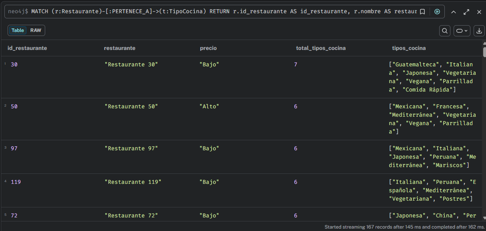

---

### 5.2 Consulta 2: Tasa de reservas por restaurante

#### Objetivo

Calcular el porcentaje de visitas realizadas con reserva para cada restaurante. Esta consulta permite identificar qué restaurantes reciben mayor cantidad de visitas planificadas por parte de los usuarios.

#### Entidades involucradas

| Entidad | Descripción |
| --- | --- |
| `Usuario` | Persona registrada en la plataforma que puede visitar restaurantes. |
| `Restaurante` | Establecimiento gastronómico que recibe visitas. |

#### Relaciones involucradas

| Relación | Descripción |
| --- | --- |
| `VISITÓ` | Relación que indica que un usuario visitó un restaurante. Contiene la propiedad `con_reserva`. |

#### Parámetros utilizados

No utiliza parámetros externos.

#### Código Cypher

```cypher
// Consulta 2: Tasa de reservas por restaurante

MATCH (:Usuario)-[v:VISITÓ]->(r:Restaurante)
WITH
    r,
    count(v) AS total_visitas,
    sum(CASE WHEN v.con_reserva = true THEN 1 ELSE 0 END) AS visitas_con_reserva
RETURN
    r.id_restaurante AS id_restaurante,
    r.nombre AS restaurante,
    total_visitas,
    visitas_con_reserva,
    round((toFloat(visitas_con_reserva) / total_visitas) * 100, 2) AS porcentaje_reservas
ORDER BY porcentaje_reservas DESC, total_visitas DESC;
```

#### Explicación

La consulta recorre las relaciones `VISITÓ` entre usuarios y restaurantes. Para cada restaurante se cuenta el total de visitas y se suman únicamente aquellas en las que la propiedad `con_reserva` tiene valor `true`.

Luego se calcula el porcentaje de reservas dividiendo las visitas con reserva entre el total de visitas del restaurante y multiplicando el resultado por 100.

#### Resultado esperado

Se espera obtener una tabla con el identificador del restaurante, nombre, total de visitas, visitas con reserva y porcentaje de reservas.

#### Interpretación

Los restaurantes con mayor porcentaje de reservas pueden considerarse establecimientos donde los usuarios planifican más sus visitas. Esto puede ser útil para analizar demanda, ocupación o comportamiento de consumo.

#### Evidencia

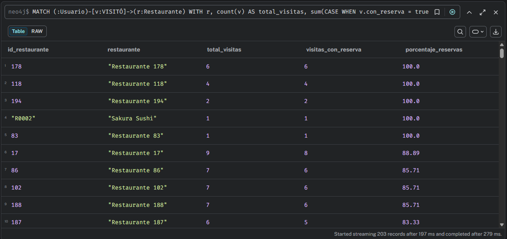

---

### 5.3 Consulta 3: Usuarios con mayor gasto promedio por visita

#### Objetivo

Identificar los usuarios que presentan el mayor gasto promedio por visita. Esta consulta permite analizar el comportamiento de consumo de los usuarios dentro del sistema.

#### Entidades involucradas

| Entidad | Descripción |
| --- | --- |
| `Usuario` | Persona que realiza visitas a restaurantes. |
| `Restaurante` | Establecimiento visitado por los usuarios. |

#### Relaciones involucradas

| Relación | Descripción |
| --- | --- |
| `VISITÓ` | Relación que almacena información de cada visita, incluyendo el consumo realizado. |

#### Parámetros utilizados

No utiliza parámetros externos.

#### Código Cypher

```cypher
// Consulta 3: Usuarios con mayor gasto promedio por visita

MATCH (u:Usuario)-[v:VISITÓ]->(r:Restaurante)
WITH
    u,
    count(v) AS total_visitas,
    avg(v.consumo) AS gasto_promedio,
    sum(v.consumo) AS gasto_total
RETURN
    u.id_usuario AS id_usuario,
    u.nombre AS usuario,
    u.email AS email,
    total_visitas,
    round(gasto_promedio, 2) AS gasto_promedio_por_visita,
    round(gasto_total, 2) AS gasto_total
ORDER BY gasto_promedio_por_visita DESC
LIMIT 20;
```

#### Explicación

La consulta busca todas las visitas realizadas por los usuarios. Luego agrupa los resultados por usuario y calcula tres métricas principales: total de visitas, gasto promedio y gasto total.

La función `avg()` calcula el consumo promedio por visita, mientras que `sum()` calcula el gasto acumulado del usuario.

#### Resultado esperado

Se espera obtener una tabla con los usuarios que tienen mayor gasto promedio por visita, mostrando también su cantidad de visitas y gasto total.

#### Interpretación

Esta consulta permite identificar usuarios con alto nivel de consumo. Desde una perspectiva de negocio, estos usuarios podrían considerarse clientes frecuentes de alto valor o candidatos para promociones personalizadas.

#### Evidencia

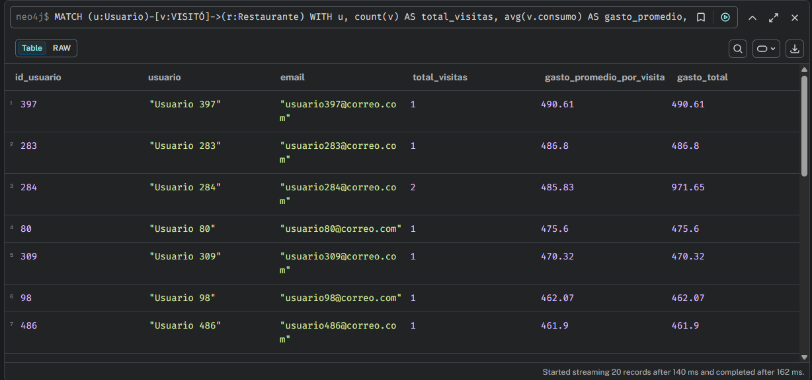

---

### 5.4 Consulta 4: Usuarios con mayor frecuencia de visitas en un periodo

#### Objetivo

Identificar los usuarios que realizaron más visitas dentro de un periodo específico. Esta consulta permite analizar frecuencia de uso y actividad de los usuarios en un rango de fechas determinado.

#### Entidades involucradas

| Entidad | Descripción |
| --- | --- |
| `Usuario` | Persona que realiza visitas dentro del sistema. |
| `Restaurante` | Restaurante visitado por los usuarios. |

#### Relaciones involucradas

| Relación | Descripción |
| --- | --- |
| `VISITÓ` | Relación que almacena la fecha en la que un usuario visitó un restaurante. |

#### Parámetros utilizados

| Parámetro | Valor utilizado | Descripción |
| --- | --- | --- |
| `fecha_inicio` | `2025-01-01` | Fecha inicial del periodo evaluado. |
| `fecha_fin` | `2025-12-31` | Fecha final del periodo evaluado. |

#### Código Cypher

```cypher
// Consulta 4: Usuarios con mayor frecuencia de visitas en un periodo

WITH date('2025-01-01') AS fecha_inicio,
     date('2025-12-31') AS fecha_fin

MATCH (u:Usuario)-[v:VISITÓ]->(r:Restaurante)
WHERE v.fecha_visita >= fecha_inicio
  AND v.fecha_visita <= fecha_fin
WITH
    u,
    count(v) AS total_visitas_periodo,
    collect(DISTINCT r.nombre)[0..5] AS restaurantes_visitados
RETURN
    u.id_usuario AS id_usuario,
    u.nombre AS usuario,
    u.email AS email,
    total_visitas_periodo,
    restaurantes_visitados
ORDER BY total_visitas_periodo DESC
LIMIT 20;
```

#### Explicación

La consulta define un rango de fechas mediante `fecha_inicio` y `fecha_fin`. Luego busca las relaciones `VISITÓ` cuya propiedad `fecha_visita` se encuentre dentro de ese periodo.

Después agrupa los resultados por usuario, cuenta el total de visitas realizadas en ese rango y muestra algunos restaurantes visitados como referencia.

#### Resultado esperado

Se espera obtener una tabla con los usuarios que realizaron mayor cantidad de visitas dentro del periodo definido.

#### Interpretación

Esta consulta permite identificar usuarios con alta frecuencia de uso de la plataforma durante un periodo específico. Puede utilizarse para analizar actividad, fidelidad o comportamiento recurrente.

#### Evidencia

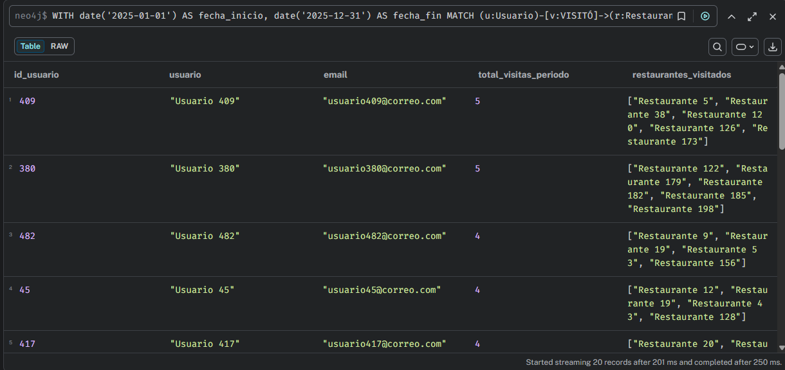

---

### 5.5 Consulta 5: Restaurantes sin visitas en los últimos N días

#### Objetivo

Identificar restaurantes que no han recibido visitas recientes dentro de un periodo definido. Esta consulta permite detectar restaurantes con baja actividad en la plataforma, lo cual puede ser útil para análisis comercial, campañas de promoción o seguimiento de establecimientos con poca interacción por parte de los usuarios.

#### Entidades involucradas

| Entidad | Descripción |
| --- | --- |
| `Restaurante` | Establecimiento gastronómico registrado en el sistema. |
| `Usuario` | Persona que utiliza la plataforma y puede visitar restaurantes. |

#### Relaciones involucradas

| Relación | Descripción |
| --- | --- |
| `VISITÓ` | Relación que indica que un usuario visitó un restaurante. |

#### Parámetros utilizados

| Parámetro | Valor utilizado | Descripción |
| --- | --- | --- |
| `fecha_referencia` | `2026-06-30` | Fecha base desde la cual se evalúa el periodo. |
| `dias_sin_visita` | `90` | Cantidad de días usados para determinar si un restaurante no ha tenido visitas recientes. |

#### Código Cypher

```cypher
// Consulta 5: Restaurantes sin visitas en los últimos N días

WITH date('2026-06-30') AS fecha_referencia,
     90 AS dias_sin_visita

MATCH (r:Restaurante)

WHERE NOT EXISTS {
    MATCH (:Usuario)-[v:VISITÓ]->(r)
    WHERE v.fecha_visita >= fecha_referencia - duration({days: dias_sin_visita})
}

OPTIONAL MATCH (:Usuario)-[ultima:VISITÓ]->(r)

RETURN
    r.id_restaurante AS id_restaurante,
    r.nombre AS restaurante,
    r.rango_precios AS rango_precios,
    max(ultima.fecha_visita) AS ultima_visita,
    dias_sin_visita AS dias_evaluados

ORDER BY ultima_visita ASC;
```

#### Explicación

La consulta inicia definiendo una fecha de referencia y una cantidad de días a evaluar. Luego se recorren todos los nodos `Restaurante` y se utiliza `NOT EXISTS` para verificar que no exista una visita reciente hacia ese restaurante dentro del periodo establecido.

Posteriormente, se utiliza `OPTIONAL MATCH` para obtener la última visita registrada, incluso si el restaurante no tiene visitas. Esto permite incluir restaurantes sin actividad y mostrar su estado dentro del análisis.

#### Resultado esperado

Se espera obtener una tabla con los restaurantes que no han recibido visitas dentro del periodo evaluado. Si un restaurante nunca ha sido visitado, el campo `ultima_visita` puede aparecer vacío.

#### Interpretación

El resultado permite identificar restaurantes con poca o nula actividad reciente. Desde el punto de vista del negocio, estos restaurantes podrían requerir promociones, revisión de su oferta gastronómica o estrategias para aumentar su visibilidad dentro del sistema.

#### Evidencia

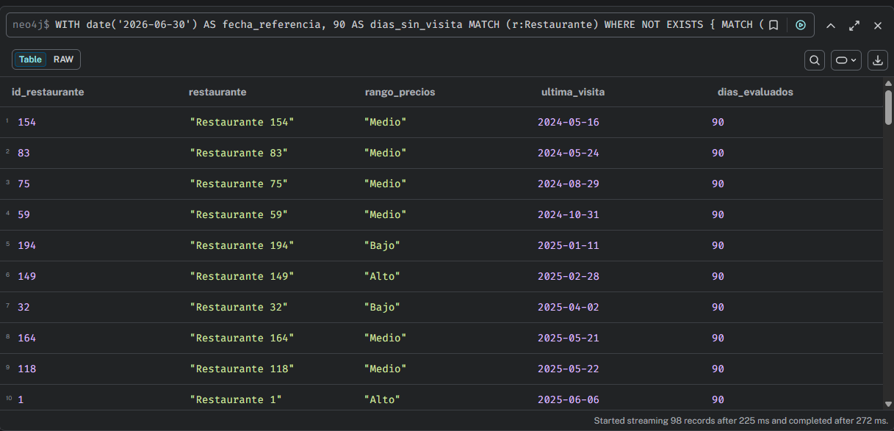

---

### 5.6 Consulta 6: Chefs con mayor movilidad laboral

#### Objetivo

Determinar cuáles chefs han trabajado en mayor cantidad de restaurantes. Esta consulta permite analizar la movilidad laboral de los chefs dentro del sistema gastronómico.

#### Entidades involucradas

| Entidad | Descripción |
| --- | --- |
| `Chef` | Persona encargada de la preparación culinaria. |
| `Restaurante` | Establecimiento en el que trabaja o ha trabajado un chef. |

#### Relaciones involucradas

| Relación | Descripción |
| --- | --- |
| `TRABAJA_EN` | Relación que conecta un chef con un restaurante e incluye propiedades como puesto y fecha de inicio. |

#### Parámetros utilizados

No utiliza parámetros externos.

#### Código Cypher

```cypher
// Consulta 6: Chefs con mayor movilidad laboral

MATCH (c:Chef)-[t:TRABAJA_EN]->(r:Restaurante)
RETURN
    c.id_chef AS id_chef,
    c.nombre AS chef,
    c.nacionalidad AS nacionalidad,
    count(r) AS total_restaurantes,
    collect(r.nombre) AS restaurantes,
    collect(t.puesto) AS puestos
ORDER BY total_restaurantes DESC;
```

#### Explicación

La consulta busca todos los chefs que tienen una relación `TRABAJA_EN` con uno o más restaurantes. Luego agrupa los resultados por chef y cuenta la cantidad de restaurantes asociados.

También se recopila el listado de restaurantes y puestos ocupados para tener mayor detalle del historial laboral.

#### Resultado esperado

Se espera obtener una tabla con los chefs ordenados por la cantidad de restaurantes en los que han trabajado.

#### Interpretación

Un chef con mayor cantidad de restaurantes asociados puede considerarse con alta movilidad laboral. Esta información puede ser útil para analizar experiencia, trayectoria o participación en diferentes establecimientos.

#### Evidencia

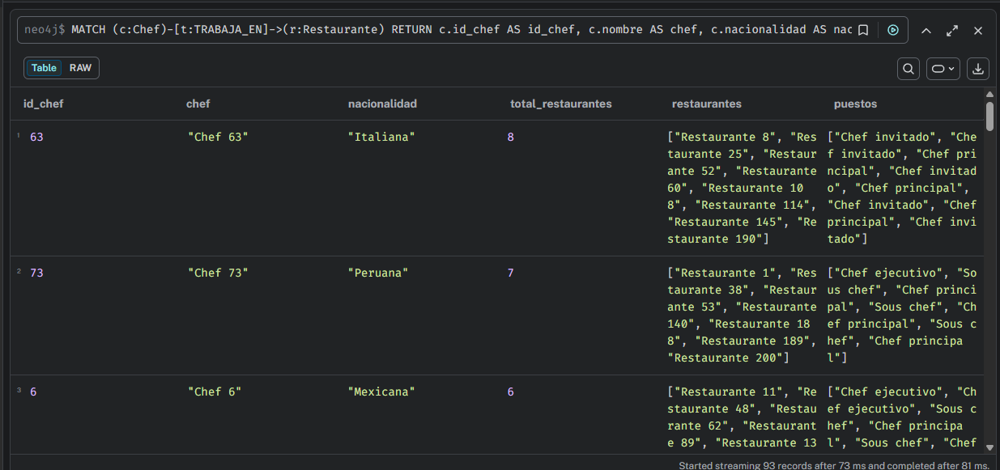
---

### 5.7 Consulta 7: Platillos con mayor variación de precio entre restaurantes

#### Objetivo

Detectar los platillos que presentan mayor variación de precio entre distintos restaurantes. Esta consulta permite comparar el precio de un mismo platillo cuando es ofrecido por diferentes establecimientos.

#### Entidades involucradas

| Entidad | Descripción |
| --- | --- |
| `Restaurante` | Establecimiento que ofrece platillos. |
| `Platillo` | Preparación gastronómica ofrecida por uno o varios restaurantes. |

#### Relaciones involucradas

| Relación | Descripción |
| --- | --- |
| `OFRECE` | Relación que conecta un restaurante con un platillo e incluye el precio ofertado. |

#### Parámetros utilizados

No utiliza parámetros externos.

#### Código Cypher

```cypher
// Consulta 7: Platillos con mayor variación de precio

MATCH (r:Restaurante)-[o:OFRECE]->(p:Platillo)
WITH
    p,
    count(r) AS total_restaurantes,
    min(o.precio) AS precio_minimo,
    max(o.precio) AS precio_maximo,
    avg(o.precio) AS precio_promedio,
    collect(r.nombre + ': Q' + toString(o.precio)) AS detalle_precios
WHERE total_restaurantes > 1
RETURN
    p.id_platillo AS id_platillo,
    p.nombre AS platillo,
    total_restaurantes,
    precio_minimo,
    precio_maximo,
    round(precio_promedio * 100) / 100 AS precio_promedio,
    precio_maximo - precio_minimo AS variacion,
    detalle_precios
ORDER BY variacion DESC;
```

#### Explicación

La consulta recorre las relaciones `OFRECE` entre restaurantes y platillos. Luego agrupa los resultados por platillo para calcular el precio mínimo, precio máximo, precio promedio y la diferencia entre el precio más alto y el más bajo.

La condición `WHERE total_restaurantes > 1` asegura que solo se analicen platillos ofrecidos por más de un restaurante, ya que solo así es posible comparar precios.

#### Resultado esperado

Se espera obtener un listado de platillos ordenados por mayor variación de precio entre restaurantes.

#### Interpretación

Los platillos con mayor variación de precio pueden indicar diferencias en calidad, presentación, ubicación del restaurante o estrategia comercial. Esta información puede apoyar análisis de precios dentro de la plataforma.

#### Evidencia

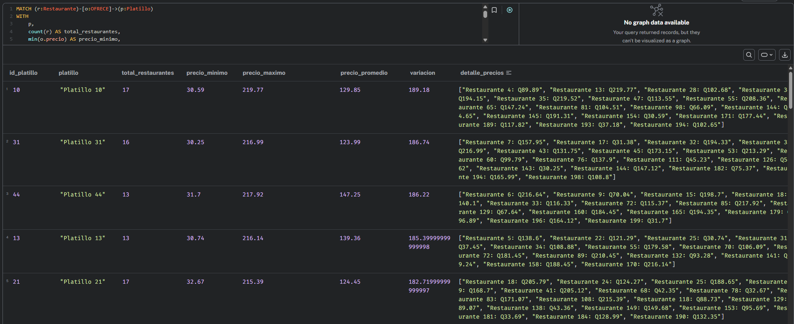

---

### 5.8 Consulta 8: Crecimiento de visitas por tipo de cocina entre dos periodos

#### Objetivo

Comparar la cantidad de visitas recibidas por cada tipo de cocina en dos periodos distintos. Esta consulta permite identificar qué categorías gastronómicas aumentaron, disminuyeron o mantuvieron su actividad dentro del sistema.

#### Entidades involucradas

| Entidad | Descripción |
| --- | --- |
| `TipoCocina` | Categoría gastronómica a la que pertenece un restaurante. |
| `Restaurante` | Establecimiento asociado a uno o varios tipos de cocina. |
| `Usuario` | Persona que realiza visitas a restaurantes. |

#### Relaciones involucradas

| Relación | Descripción |
| --- | --- |
| `PERTENECE_A` | Relación entre un restaurante y un tipo de cocina. |
| `VISITÓ` | Relación entre un usuario y un restaurante visitado. |

#### Parámetros utilizados

| Parámetro | Valor utilizado | Descripción |
| --- | --- | --- |
| `inicio_periodo_1` | `2026-01-01` | Fecha inicial del primer periodo. |
| `fin_periodo_1` | `2026-03-31` | Fecha final del primer periodo. |
| `inicio_periodo_2` | `2026-04-01` | Fecha inicial del segundo periodo. |
| `fin_periodo_2` | `2026-06-30` | Fecha final del segundo periodo. |

#### Código Cypher

```cypher
// Consulta 8: Crecimiento de visitas por tipo de cocina

WITH date('2026-01-01') AS inicio_periodo_1,
     date('2026-03-31') AS fin_periodo_1,
     date('2026-04-01') AS inicio_periodo_2,
     date('2026-06-30') AS fin_periodo_2

MATCH (t:TipoCocina)

OPTIONAL MATCH (t)<-[:PERTENECE_A]-(r1:Restaurante)<-[v1:VISITÓ]-(:Usuario)
WHERE v1.fecha_visita >= inicio_periodo_1
  AND v1.fecha_visita <= fin_periodo_1

WITH t, inicio_periodo_1, fin_periodo_1, inicio_periodo_2, fin_periodo_2,
     count(DISTINCT v1) AS visitas_periodo_1

OPTIONAL MATCH (t)<-[:PERTENECE_A]-(r2:Restaurante)<-[v2:VISITÓ]-(:Usuario)
WHERE v2.fecha_visita >= inicio_periodo_2
  AND v2.fecha_visita <= fin_periodo_2

WITH t,
     visitas_periodo_1,
     count(DISTINCT v2) AS visitas_periodo_2

RETURN
    t.id_tipo_cocina AS id_tipo_cocina,
    t.nombre AS tipo_cocina,
    visitas_periodo_1,
    visitas_periodo_2,
    visitas_periodo_2 - visitas_periodo_1 AS diferencia_visitas,
    CASE
        WHEN visitas_periodo_1 = 0 AND visitas_periodo_2 > 0 THEN 100.0
        WHEN visitas_periodo_1 = 0 AND visitas_periodo_2 = 0 THEN 0.0
        ELSE round(((toFloat(visitas_periodo_2 - visitas_periodo_1) / visitas_periodo_1) * 100) * 100) / 100
    END AS porcentaje_crecimiento

ORDER BY porcentaje_crecimiento DESC;
```

#### Explicación

La consulta define dos rangos de fechas para comparar el comportamiento de visitas. Primero se recorren los nodos `TipoCocina`. Luego, mediante `OPTIONAL MATCH`, se cuentan las visitas asociadas a restaurantes de cada tipo de cocina durante el primer periodo.

Después, utilizando `WITH`, se conserva el conteo del primer periodo y se realiza un segundo conteo para el periodo siguiente. Finalmente, se calcula la diferencia entre ambos periodos y el porcentaje de crecimiento.

La expresión `CASE` permite evitar divisiones entre cero cuando un tipo de cocina no tuvo visitas en el primer periodo.

#### Resultado esperado

Se espera obtener un listado de tipos de cocina con visitas del primer periodo, visitas del segundo periodo, diferencia de visitas y porcentaje de crecimiento.

#### Interpretación

Esta consulta permite analizar tendencias de consumo. Un crecimiento positivo indica que el tipo de cocina recibió más visitas en el segundo periodo. Un valor negativo indica disminución de actividad. Esta información puede apoyar decisiones sobre promociones, recomendaciones o análisis de preferencias gastronómicas.

#### Evidencia

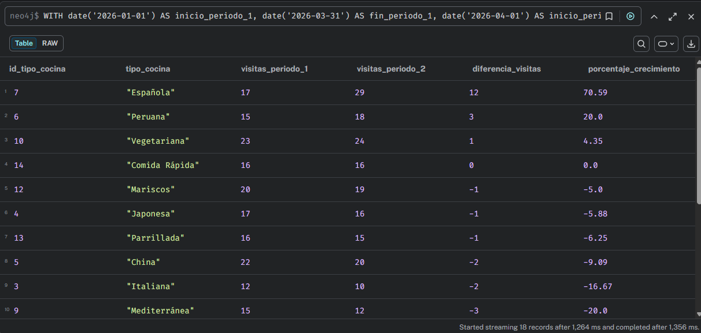

---

### 5.9 Consulta 9: Recomendación de restaurantes a un usuario

#### Objetivo

Recomendar restaurantes a un usuario específico tomando como base restaurantes que calificó positivamente, chefs compartidos y restaurantes que aún no ha visitado. Esta consulta representa la funcionalidad principal del sistema de recomendación.

#### Entidades involucradas

| Entidad | Descripción |
| --- | --- |
| `Usuario` | Persona a quien se le genera la recomendación. |
| `Restaurante` | Establecimiento evaluado como posible recomendación. |
| `Chef` | Profesional culinario que conecta restaurantes entre sí. |
| `TipoCocina` | Categoría gastronómica del restaurante recomendado. |

#### Relaciones involucradas

| Relación | Descripción |
| --- | --- |
| `CALIFICÓ` | Relación donde un usuario califica un restaurante. |
| `VISITÓ` | Relación usada para evitar recomendar restaurantes ya visitados. |
| `TRABAJA_EN` | Relación que conecta chefs con restaurantes. |
| `PERTENECE_A` | Relación que identifica el tipo de cocina del restaurante. |

#### Parámetros utilizados

| Parámetro | Valor utilizado | Descripción |
| --- | --- | --- |
| `id_usuario` | `137` | Usuario al que se le generan recomendaciones. |
| `puntuacion_minima` | `4` | Calificación mínima para considerar un restaurante como referencia positiva. |

#### Código Cypher

```cypher
// Consulta 9: Recomendación de restaurantes a un usuario

WITH 137 AS id_usuario,
     4 AS puntuacion_minima

MATCH (u:Usuario {id_usuario: id_usuario})-[cal:CALIFICÓ]->(r_base:Restaurante)
WHERE cal.puntuacion >= puntuacion_minima

MATCH (chef:Chef)-[:TRABAJA_EN]->(r_base)
MATCH (chef)-[:TRABAJA_EN]->(r_recomendado:Restaurante)

WHERE r_recomendado <> r_base
  AND NOT EXISTS {
      MATCH (u)-[:VISITÓ]->(r_recomendado)
  }

OPTIONAL MATCH (r_recomendado)-[:PERTENECE_A]->(tipo:TipoCocina)
OPTIONAL MATCH (r_recomendado)<-[calificacion:CALIFICÓ]-(:Usuario)

WITH
    r_recomendado,
    collect(DISTINCT chef.nombre) AS chefs_compartidos,
    collect(DISTINCT r_base.nombre) AS restaurantes_base,
    collect(DISTINCT tipo.nombre) AS tipos_cocina,
    avg(calificacion.puntuacion) AS promedio_calificacion,
    count(DISTINCT chef) AS coincidencias_chefs

RETURN
    r_recomendado.id_restaurante AS id_restaurante,
    r_recomendado.nombre AS restaurante_recomendado,
    r_recomendado.rango_precios AS rango_precios,
    chefs_compartidos,
    restaurantes_base,
    tipos_cocina,
    coincidencias_chefs,
    round(coalesce(promedio_calificacion, 0) * 100) / 100 AS promedio_calificacion

ORDER BY coincidencias_chefs DESC, promedio_calificacion DESC
LIMIT 10;
```

#### Explicación

La consulta inicia seleccionando un usuario específico mediante su identificador numérico. Luego busca los restaurantes que ese usuario calificó con una puntuación igual o mayor a 4. Estos restaurantes se consideran referencias positivas.

A partir de esos restaurantes, se identifican los chefs que trabajan en ellos. Luego se buscan otros restaurantes donde también trabajen esos chefs. Estos restaurantes se consideran candidatos a recomendación porque comparten chefs con restaurantes que el usuario valoró positivamente.

Para evitar recomendar restaurantes repetidos, se utiliza `NOT EXISTS`, verificando que el usuario no haya visitado previamente el restaurante candidato. También se agregan datos complementarios como tipos de cocina y promedio de calificación general.

#### Resultado esperado

Se espera obtener un listado de restaurantes recomendados para el usuario, mostrando restaurante recomendado, rango de precios, chefs compartidos, restaurantes base, tipos de cocina, coincidencias de chefs y promedio de calificación.

#### Interpretación

Esta consulta demuestra el uso de Neo4j como base de datos orientada a grafos, ya que la recomendación no se basa únicamente en datos aislados, sino en conexiones entre usuarios, restaurantes y chefs. El sistema puede sugerir restaurantes que tienen relación indirecta con lugares que el usuario ya calificó positivamente.

#### Evidencia

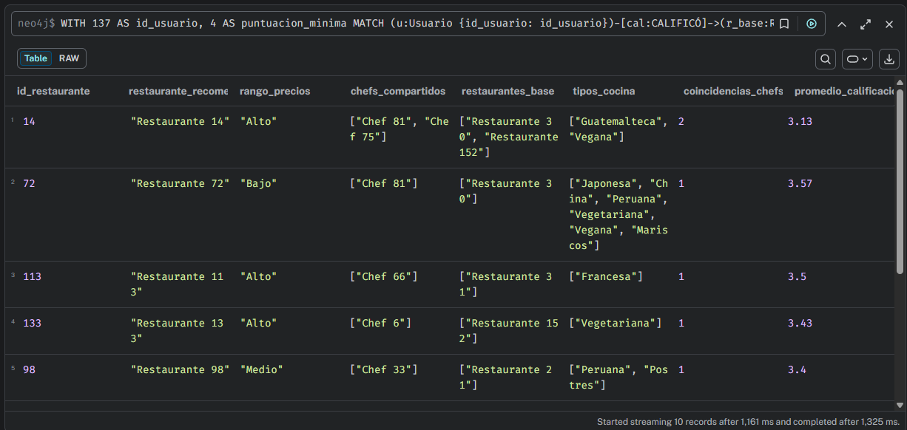

---

## 6. Análisis de red

Además de las consultas de negocio, se implementó un análisis de red basado en rutas entre usuarios. Este análisis permite aprovechar una de las principales ventajas de Neo4j: recorrer conexiones entre nodos de forma directa y eficiente.

---

### 6.1 Ruta más corta entre usuarios

#### Objetivo

Calcular los grados de separación entre dos usuarios utilizando la relación de amistad `ES_AMIGO_DE`. Este análisis permite identificar qué tan conectados están dos usuarios dentro de la red social gastronómica.

#### Entidades involucradas

| Entidad   | Descripción                                 |
| --------- | ------------------------------------------- |
| `Usuario` | Persona registrada dentro de la plataforma. |

#### Relaciones involucradas

| Relación      | Descripción                                               |
| ------------- | --------------------------------------------------------- |
| `ES_AMIGO_DE` | Relación que conecta a dos usuarios mediante una amistad. |

#### Parámetros utilizados

| Parámetro         | Valor utilizado | Descripción                             |
| ----------------- | --------------- | --------------------------------------- |
| `usuario_origen`  | `U0001`         | Usuario desde donde inicia la búsqueda. |
| `usuario_destino` | `U0003`         | Usuario destino al que se desea llegar. |

#### Código Cypher

```cypher
// Análisis de red: Ruta más corta entre usuarios

// Parámetros de prueba
WITH "U0001" AS usuario_origen,
     "U0003" AS usuario_destino

MATCH (origen:Usuario {id_usuario: usuario_origen})
MATCH (destino:Usuario {id_usuario: usuario_destino})

MATCH ruta = shortestPath((origen)-[:ES_AMIGO_DE*..6]-(destino))

RETURN
    origen.nombre AS usuario_origen,
    destino.nombre AS usuario_destino,
    length(ruta) AS grados_separacion,
    [nodo IN nodes(ruta) | nodo.nombre] AS usuarios_en_ruta,
    ruta;
```

#### Explicación

La consulta define un usuario origen y un usuario destino. Luego busca ambos nodos `Usuario` dentro del grafo. Después se utiliza la función `shortestPath`, que permite encontrar la ruta más corta entre ambos usuarios siguiendo relaciones `ES_AMIGO_DE`.

El patrón `[:ES_AMIGO_DE*..6]` permite recorrer relaciones de amistad con una profundidad máxima de seis niveles. Esto evita recorridos demasiado extensos y mantiene controlado el análisis.

Finalmente, se devuelve el usuario origen, el usuario destino, los grados de separación, los usuarios intermedios en la ruta y el grafo de la ruta encontrada.

#### Resultado esperado

Se espera obtener la ruta más corta entre dos usuarios conectados mediante relaciones de amistad. El resultado debe mostrar cuántos grados de separación existen entre ambos y qué usuarios forman parte del camino.

#### Interpretación

Este análisis permite observar la conectividad social dentro del sistema. Si dos usuarios están conectados por pocos grados de separación, significa que pertenecen a una red cercana de amistad. Esta información podría utilizarse posteriormente para recomendaciones basadas en amigos, gustos compartidos o visitas realizadas por usuarios cercanos dentro del grafo.

#### Evidencia


---

## 7. Aporte del Integrante 3

El aporte del Integrante 3 se enfocó en la construcción de consultas analíticas, sistema de recomendación y análisis de red dentro del proyecto de restaurantes en Neo4j.

Las consultas desarrolladas permiten detectar restaurantes sin visitas recientes, analizar el crecimiento de visitas por tipo de cocina y recomendar restaurantes a usuarios específicos utilizando relaciones del grafo. Además, se implementó un análisis de ruta más corta entre usuarios, con el objetivo de evaluar la conectividad social dentro del sistema.

Este aporte contribuye directamente al objetivo principal del proyecto, ya que demuestra cómo Neo4j permite analizar relaciones complejas entre usuarios, restaurantes, chefs, visitas, calificaciones y tipos de cocina. A diferencia de un modelo relacional tradicional, el enfoque basado en grafos facilita recorrer conexiones indirectas y encontrar patrones útiles para recomendaciones.
