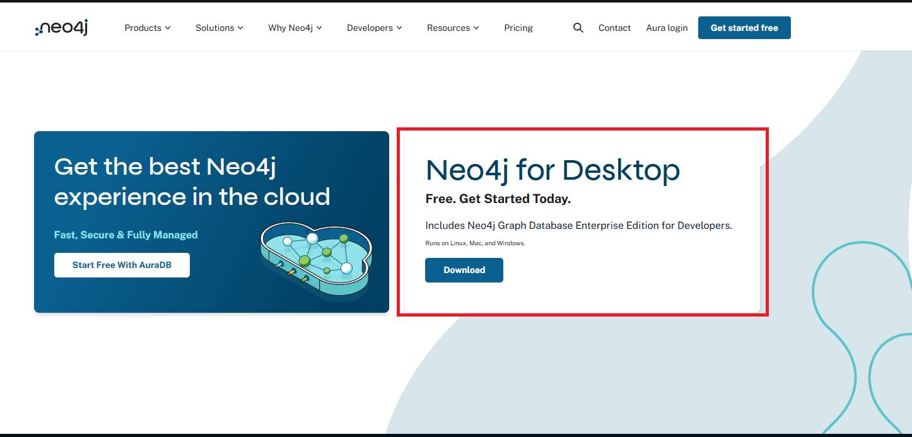
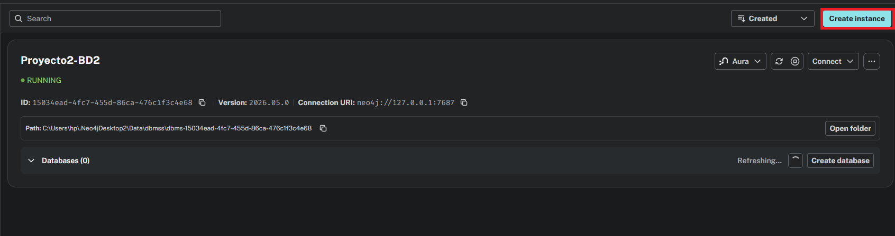
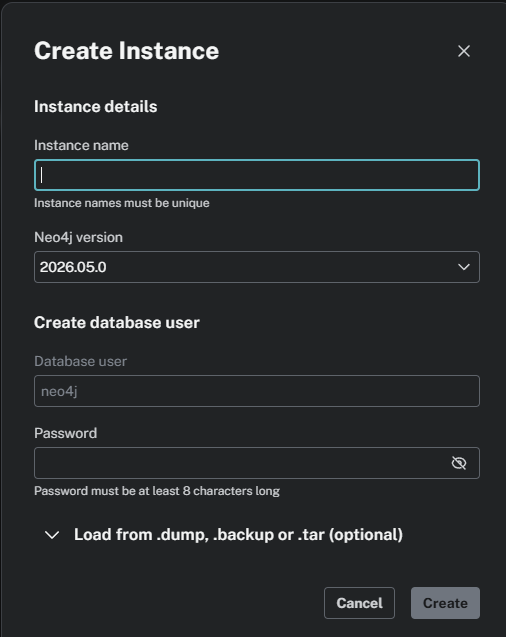
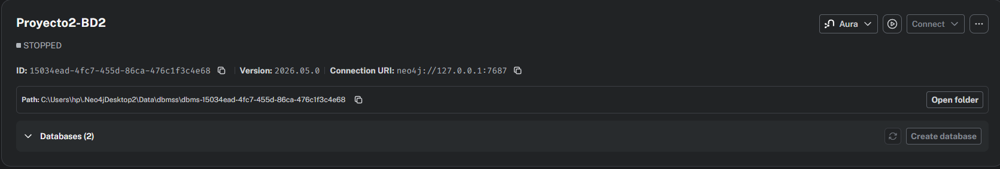
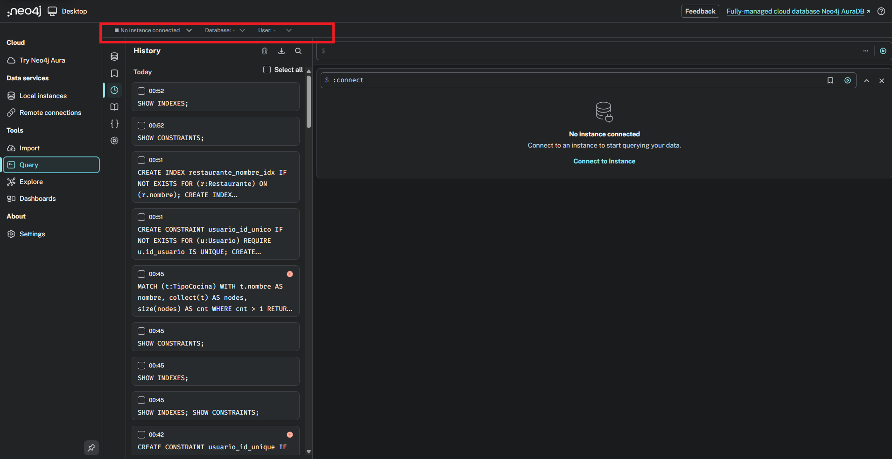
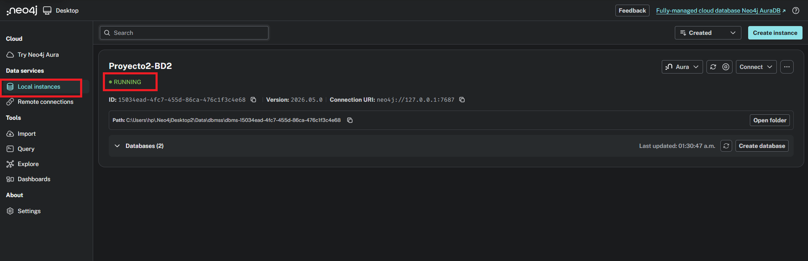
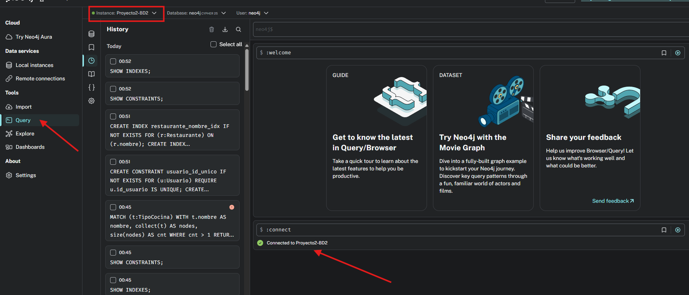
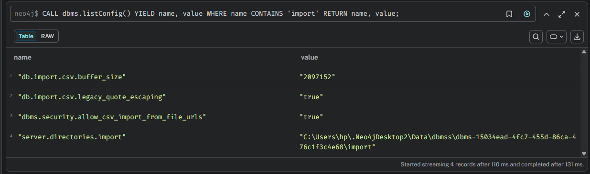

<div align="center">

**Universidad de San Carlos de Guatemala**  
**Facultad de Ingeniería**  
**Sistema de Bases de Datos 2 - Proyecto 2**  

**Grupo - 13**  

**Participantes:**  
**Daniel Estuardo Salvatierra Macajola - 202202768**  
**Daniel Alejandro Castellanos Rodríguez - 202200176**  
**Carlos Fernando Matta Peña - 202302190**  

**Guatemala, 22 de Junio de 2026**

</div>

<h1 align="center">Manual de Usuario</h1>

<h2 align="center">Sistema de Recomendación de Restaurantes con Neo4j</h2>

---

## Tabla de Contenidos

1. [Introducción](#1-introducción)  
2. [Requisitos previos](#2-requisitos-previos)  
3. [Instalación de Neo4j](#3-instalación-de-neo4j)  
4. [Configuración inicial de la base de datos](#4-configuración-inicial-de-la-base-de-datos)  
5. [Estructura de archivos del proyecto](#5-estructura-de-archivos-del-proyecto)  
6. [Carga de datos iniciales](#6-carga-de-datos-iniciales)  
7. [Validación de la carga de datos](#7-validación-de-la-carga-de-datos)  
8. [Ejecución de consultas Cypher](#8-ejecución-de-consultas-cypher)  
9. [Interpretación de la consulta de recomendación](#9-interpretación-de-la-consulta-de-recomendación)  
10. [Análisis de red](#10-análisis-de-red)  
11. [Resolución de problemas comunes](#11-resolución-de-problemas-comunes)  
12. [Conclusiones del manual de usuario](#12-conclusiones-del-manual-de-usuario)  

---

## 1. Introducción

Este manual de usuario explica cómo instalar, configurar y utilizar la base de datos Neo4j desarrollada para el sistema de recomendación de restaurantes.

El sistema permite representar usuarios, restaurantes, chefs, platillos y tipos de cocina mediante un modelo de grafos. A través de consultas Cypher, el usuario puede analizar visitas, reservas, gasto promedio, frecuencia de visitas, movilidad de chefs, variación de precios, crecimiento de visitas por tipo de cocina y recomendaciones personalizadas de restaurantes.

El objetivo de este documento es guiar al usuario final para que pueda:

- Instalar y abrir Neo4j.
- Crear o iniciar la base de datos del proyecto.
- Cargar los datos iniciales mediante archivos CSV.
- Ejecutar las consultas Cypher implementadas.
- Interpretar los resultados obtenidos.
- Resolver problemas comunes durante la ejecución.

---

## 2. Requisitos previos

Antes de ejecutar el proyecto, se debe contar con los siguientes elementos instalados o disponibles:

| Requisito | Descripción |
|---|---|
| Neo4j Desktop o Neo4j Community Edition | Motor de base de datos de grafos utilizado en el proyecto |
| Neo4j Browser | Interfaz para ejecutar consultas Cypher |
| Archivos CSV del proyecto | Datos de usuarios, restaurantes, chefs, platillos, tipos de cocina y relaciones |
| Scripts Cypher | Archivos utilizados para crear constraints, cargar datos y ejecutar consultas |
| Sistema operativo | Windows, Linux o macOS |
| Editor de texto recomendado | Visual Studio Code, Notepad++ o cualquier editor de texto |

---

## 3. Instalación de Neo4j

### 3.1 Descargar Neo4j Desktop

1. Ingresar al sitio oficial de Neo4j (https://neo4j.com/download/).
2. Descargar **Neo4j Desktop**.
3. Instalar Neo4j siguiendo el asistente de instalación.
4. Abrir Neo4j Desktop.
5. Crear una cuenta o iniciar sesión si la herramienta lo solicita.



### 3.2 Crear un proyecto en Neo4j Desktop

1. Abrir Neo4j Desktop.
2. Seleccionar la opción **New Project**.
3. Asignar un nombre al proyecto, por ejemplo:



```text
Sistema_Recomendacion_Restaurantes
```

4. Dentro del proyecto, seleccionar **Add DBMS** o **Create Database**.
5. Asignar un nombre a la base de datos, por ejemplo:

```text
restaurantes-neo4j
```

6. Definir una contraseña para el usuario `neo4j`.

Ejemplo:

```text
Usuario: neo4j
Contraseña: neo4j123
```

> Nota: La contraseña puede variar según la configuración local del usuario.


---

## 4. Configuración inicial de la base de datos

### 4.1 Iniciar la base de datos

1. Abrir Neo4j Desktop.
2. Seleccionar el proyecto creado.
3. Buscar la base de datos del proyecto.
4. Presionar el botón **Start**.
5. Esperar a que el estado cambie a **Running**.



### 4.2 Abrir Neo4j Browser

1. Con la base de datos encendida, presionar **Open**.
2. Seleccionar **Neo4j Browser**.
3. Iniciar sesión con las credenciales configuradas.

Ejemplo:

```text
Usuario: neo4j
Contraseña: neo4j123
```


### 4.3 Verificar conexión

Dentro de Neo4j Browser, ejecutar:

```cypher
RETURN 'Conexión exitosa a Neo4j' AS mensaje;
```

Si la conexión es correcta, Neo4j mostrará una tabla con el mensaje:

```text
Conexión exitosa a Neo4j
```




---

## 5. Estructura de archivos del proyecto

El proyecto se encuentra organizado de la siguiente manera:

```text
BD2_VACJUN26_Proyectos_G13/
└── Segundo Proyecto/
    ├── README.md
    ├── data/
    │   ├── usuarios.csv
    │   ├── restaurantes.csv
    │   ├── chefs.csv
    │   ├── platillos.csv
    │   ├── tipos_cocina.csv
    │   ├── califico.csv
    │   ├── visito.csv
    │   ├── amistades.csv
    │   ├── pertenece_a.csv
    │   ├── ofrece.csv
    │   ├── prepara.csv
    │   ├── trabaja_en.csv
    │   └── le_gusta.csv
    ├── scripts/
    │   ├── 01_constraints_indices.cypher
    │   ├── 04_load_nodes.cypher
    │   ├── 05_load_relationships.cypher
    │   ├── 06_validacion_carga.cypher
    │   ├── consultas_integrante_1.cypher
    │   ├── consultas_integrante_2.cypher
    │   ├── consultas_integrante_3.cypher
    │   ├── restaurantes_conectados.cypher
    │   └── ruta_mas_corta.cypher
    ├── documentacion/
    │   ├── Manual_Tecnico.md
    │   ├── Manual_Usuario.md
    │   ├── Diagrama_Modelo_Grafos.png
    │   └── image/
    └── src/
        └── generar_datos.py
```

---

## 6. Carga de datos iniciales

La carga de datos iniciales del proyecto se realiza mediante archivos CSV y scripts Cypher utilizando `LOAD CSV WITH HEADERS`. Antes de ejecutar la carga en Neo4j, es necesario generar los archivos CSV con el script de Python incluido en el proyecto y copiarlos al directorio `import` de la base de datos.

El flujo correcto de esta sección es:

1. Generar los archivos CSV con Python.
2. Copiar los archivos CSV al directorio `import` de Neo4j.
3. Crear constraints e índices.
4. Cargar los nodos.
5. Cargar las relaciones.
6. Validar la carga de datos.

---

### 6.1 Generación de archivos CSV con Python

El proyecto incluye un script llamado `generar_datos.py`, ubicado dentro de la carpeta `scripts`. Este script se encarga de generar automáticamente los archivos CSV necesarios para cargar los nodos y relaciones del grafo.

La ubicación del script es:

```text
Segundo Proyecto/
└── scripts/
    └── generar_datos.py
```

Para ejecutar el script, primero se debe abrir una terminal o PowerShell en la carpeta raíz del proyecto:

```bash
cd "Segundo Proyecto"
```

Luego se ejecuta el script con Python:

```bash
python scripts/generar_datos.py
```

En algunos equipos, el comando puede ser:

```bash
py scripts/generar_datos.py
```

Si la ejecución fue correcta, se mostrarán mensajes indicando que los archivos fueron generados dentro de la carpeta `data`.

Ejemplo de salida esperada:

```text
Archivo generado: data/usuarios.csv
Archivo generado: data/restaurantes.csv
Archivo generado: data/chefs.csv
Archivo generado: data/platillos.csv
Archivo generado: data/tipos_cocina.csv
Archivo generado: data/califico.csv
Archivo generado: data/visito.csv
Archivo generado: data/amistades.csv
Archivo generado: data/pertenece_a.csv
Archivo generado: data/ofrece.csv
Archivo generado: data/prepara.csv
Archivo generado: data/trabaja_en.csv
Archivo generado: data/le_gusta.csv
Generación de datos completada correctamente.
```

Después de ejecutar el script, la carpeta `data` debe contener todos los archivos CSV requeridos para la carga masiva.

---

### 6.2 Archivos CSV utilizados

Los archivos CSV generados representan tanto los nodos como las relaciones del modelo de grafos.

| Archivo | Descripción |
|---|---|
| `usuarios.csv` | Contiene los usuarios del sistema |
| `restaurantes.csv` | Contiene los restaurantes registrados |
| `chefs.csv` | Contiene los chefs |
| `platillos.csv` | Contiene los platillos |
| `tipos_cocina.csv` | Contiene los tipos de cocina |
| `califico.csv` | Contiene las relaciones de calificación entre usuarios y restaurantes |
| `visito.csv` | Contiene las relaciones de visita entre usuarios y restaurantes |
| `amistades.csv` | Contiene las relaciones de amistad entre usuarios |
| `pertenece_a.csv` | Contiene la relación entre restaurantes y tipos de cocina |
| `ofrece.csv` | Contiene la relación entre restaurantes y platillos |
| `prepara.csv` | Contiene la relación entre chefs y platillos |
| `trabaja_en.csv` | Contiene la relación entre chefs y restaurantes |
| `le_gusta.csv` | Contiene la relación entre usuarios y tipos de cocina |

La estructura esperada dentro del proyecto es:

```text
Segundo Proyecto/
└── data/
    ├── usuarios.csv
    ├── restaurantes.csv
    ├── chefs.csv
    ├── platillos.csv
    ├── tipos_cocina.csv
    ├── califico.csv
    ├── visito.csv
    ├── amistades.csv
    ├── pertenece_a.csv
    ├── ofrece.csv
    ├── prepara.csv
    ├── trabaja_en.csv
    └── le_gusta.csv
```

---

### 6.3 Cantidades generadas

El script genera las cantidades mínimas solicitadas para el proyecto.

| Tipo de dato | Cantidad |
|---|---:|
| Usuarios | 500 |
| Restaurantes | 200 |
| Chefs | 100 |
| Platillos | 50 |
| Tipos de cocina | 15 |

Además, genera relaciones suficientes para validar las consultas Cypher del sistema.

| Relación | Cantidad aproximada |
|---|---:|
| `CALIFICÓ` | 1200 |
| `VISITÓ` | 1600 |
| `ES_AMIGO_DE` | 900 |
| `LE_GUSTA` | 1000 |
| `PERTENECE_A` | 350 |
| `OFRECE` | 800 |
| `PREPARA` | 350 |
| `TRABAJA_EN` | 250 |

Estas cantidades permiten que las consultas de visitas, reservas, calificaciones, recomendaciones y análisis de red devuelvan resultados útiles.

---

### 6.4 Copiar archivos CSV al directorio import de Neo4j

Para que Neo4j pueda leer los archivos con `LOAD CSV`, los CSV deben copiarse al directorio `import` de la base de datos.

Pasos:

1. Abrir Neo4j Desktop.
2. Seleccionar la base de datos del proyecto.
3. Abrir Neo4j Browser.
4. Ejecutar la siguiente consulta para identificar el directorio `import` real de la base de datos:

```cypher
CALL dbms.listConfig()
YIELD name, value
WHERE name CONTAINS 'import'
RETURN name, value;
```

El resultado mostrará una ruta similar a esta:

```text
C:\Users\hp\.Neo4jDesktop2\Data\dbmss\dbms-xxxxxxxx\import
```



5. Abrir esa carpeta desde el Explorador de archivos de Windows.
6. Copiar dentro de esa carpeta todos los archivos `.csv` ubicados en la carpeta `data` del proyecto.

La carpeta `import` debe quedar similar a esto:

```text
import/
├── usuarios.csv
├── restaurantes.csv
├── chefs.csv
├── platillos.csv
├── tipos_cocina.csv
├── califico.csv
├── visito.csv
├── amistades.csv
├── pertenece_a.csv
├── ofrece.csv
├── prepara.csv
├── trabaja_en.csv
└── le_gusta.csv
```

> Importante: no basta con que los archivos aparezcan en la pestaña **Import** de Neo4j Desktop. Los CSV deben estar físicamente dentro del directorio `import` de la base de datos que se está ejecutando.

---

### 6.5 Verificar lectura de los archivos CSV

Antes de ejecutar la carga completa, se recomienda verificar que Neo4j pueda leer los archivos CSV correctamente.

Ejecutar en Neo4j Browser:

```cypher
LOAD CSV WITH HEADERS
FROM 'file:///usuarios.csv' AS row
RETURN row
LIMIT 5;
```

Si Neo4j muestra las primeras filas del archivo `usuarios.csv`, significa que la lectura fue correcta.

También se puede verificar otro archivo:

```cypher
LOAD CSV WITH HEADERS
FROM 'file:///tipos_cocina.csv' AS row
RETURN row
LIMIT 5;
```

Si aparece un error similar a:

```text
Could not load external resource from file:///usuarios.csv
```

significa que el archivo no se encuentra en el directorio `import` correcto. En ese caso, se debe revisar nuevamente la ruta obtenida mediante `CALL dbms.listConfig()` y copiar los archivos CSV en dicha carpeta.

---

### 6.6 Crear constraints e índices

Antes de cargar los datos, se recomienda ejecutar el archivo:

```text
scripts/01_constraints_indices.cypher
```

Este archivo crea restricciones de unicidad e índices para mejorar la integridad y el rendimiento de la base de datos.

Para ejecutarlo:

1. Abrir el archivo `01_constraints_indices.cypher`.
2. Copiar su contenido.
3. Pegar el contenido en Neo4j Browser.
4. Presionar el botón **Run**.

También se pueden ejecutar manualmente las instrucciones principales:

```cypher
CREATE CONSTRAINT usuario_id_unico IF NOT EXISTS
FOR (u:Usuario)
REQUIRE u.id_usuario IS UNIQUE;

CREATE CONSTRAINT usuario_email_unico IF NOT EXISTS
FOR (u:Usuario)
REQUIRE u.email IS UNIQUE;

CREATE CONSTRAINT restaurante_id_unico IF NOT EXISTS
FOR (r:Restaurante)
REQUIRE r.id_restaurante IS UNIQUE;

CREATE CONSTRAINT chef_id_unico IF NOT EXISTS
FOR (c:Chef)
REQUIRE c.id_chef IS UNIQUE;

CREATE CONSTRAINT platillo_id_unico IF NOT EXISTS
FOR (p:Platillo)
REQUIRE p.id_platillo IS UNIQUE;

CREATE CONSTRAINT tipococina_id_unico IF NOT EXISTS
FOR (t:TipoCocina)
REQUIRE t.id_tipo_cocina IS UNIQUE;
```

Para verificar que las restricciones fueron creadas correctamente, se puede ejecutar:

```cypher
SHOW CONSTRAINTS;
```

Para verificar los índices:

```cypher
SHOW INDEXES;
```

---

### 6.7 Cargar nodos

Después de crear constraints e índices, se debe ejecutar el archivo:

```text
scripts/04_load_nodes.cypher
```

Este archivo carga los nodos principales del grafo:

- `Usuario`
- `Restaurante`
- `Chef`
- `Platillo`
- `TipoCocina`

Ejemplo de carga de usuarios:

```cypher
LOAD CSV WITH HEADERS
FROM 'file:///usuarios.csv' AS row
MERGE (u:Usuario {id_usuario: toInteger(row.id_usuario)})
SET
    u.nombre = row.nombre,
    u.email = row.email,
    u.edad = toInteger(row.edad),
    u.pais = row.pais;
```

El uso de `MERGE` permite evitar duplicados, ya que si un nodo con el mismo identificador ya existe, Neo4j no lo vuelve a crear.

Después de cargar los nodos, se puede validar la cantidad total con:

```cypher
MATCH (n)
RETURN labels(n) AS etiqueta, count(n) AS total
ORDER BY total DESC;
```

Resultado esperado:

| Etiqueta | Total |
|---|---:|
| `Usuario` | 500 |
| `Restaurante` | 200 |
| `Chef` | 100 |
| `Platillo` | 50 |
| `TipoCocina` | 15 |

---

### 6.8 Cargar relaciones

Luego de cargar los nodos, se debe ejecutar el archivo:

```text
scripts/05_load_relationships.cypher
```

Este archivo crea las relaciones entre nodos:

- `CALIFICÓ`
- `VISITÓ`
- `ES_AMIGO_DE`
- `PERTENECE_A`
- `OFRECE`
- `PREPARA`
- `TRABAJA_EN`
- `LE_GUSTA`

Ejemplo de carga de visitas:

```cypher
LOAD CSV WITH HEADERS
FROM 'file:///visito.csv' AS row
MATCH (u:Usuario {id_usuario: toInteger(row.id_usuario)})
MATCH (r:Restaurante {id_restaurante: toInteger(row.id_restaurante)})
CREATE (u)-[v:VISITÓ]->(r)
SET
    v.fecha_visita = date(row.fecha_visita),
    v.consumo = toFloat(row.consumo),
    v.con_reserva = toBoolean(row.con_reserva);
```

> Importante: las relaciones deben cargarse después de los nodos, porque necesitan que los usuarios, restaurantes, chefs, platillos y tipos de cocina ya existan en la base de datos.

Después de cargar las relaciones, se puede validar la cantidad total con:

```cypher
MATCH ()-[r]->()
RETURN type(r) AS relacion, count(r) AS total
ORDER BY total DESC;
```

Resultado esperado aproximado:

| Relación | Total aproximado |
|---|---:|
| `VISITÓ` | 1600 |
| `CALIFICÓ` | 1200 |
| `LE_GUSTA` | 1000 |
| `ES_AMIGO_DE` | 900 |
| `OFRECE` | 800 |
| `PERTENECE_A` | 350 |
| `PREPARA` | 350 |
| `TRABAJA_EN` | 250 |

---

### 6.9 Validar la carga completa

Finalmente, se debe ejecutar el archivo:

```text
scripts/06_validacion_carga.cypher
```

Este archivo contiene consultas para verificar que los nodos, relaciones y propiedades principales hayan sido cargados correctamente.

#### Validación general de nodos

```cypher
MATCH (u:Usuario)
WITH count(u) AS usuarios
MATCH (r:Restaurante)
WITH usuarios, count(r) AS restaurantes
MATCH (c:Chef)
WITH usuarios, restaurantes, count(c) AS chefs
MATCH (p:Platillo)
WITH usuarios, restaurantes, chefs, count(p) AS platillos
MATCH (t:TipoCocina)
RETURN
    usuarios,
    restaurantes,
    chefs,
    platillos,
    count(t) AS tipos_cocina;
```

Resultado esperado:

| Usuarios | Restaurantes | Chefs | Platillos | Tipos de cocina |
|---:|---:|---:|---:|---:|
| 500 | 200 | 100 | 50 | 15 |

#### Validación general de relaciones

```cypher
MATCH ()-[r]->()
RETURN
    type(r) AS relacion,
    count(r) AS total
ORDER BY total DESC;
```

#### Validación de datos incompletos

```cypher
MATCH (u:Usuario)
WHERE u.email IS NULL OR u.nombre IS NULL
WITH count(u) AS usuarios_incompletos

MATCH (r:Restaurante)
WHERE r.nombre IS NULL OR r.rango_precios IS NULL
WITH usuarios_incompletos, count(r) AS restaurantes_incompletos

MATCH ()-[v:VISITÓ]->()
WHERE v.consumo IS NULL OR v.fecha_visita IS NULL OR v.con_reserva IS NULL
WITH usuarios_incompletos, restaurantes_incompletos, count(v) AS visitas_incompletas

MATCH ()-[c:CALIFICÓ]->()
WHERE c.puntuacion IS NULL OR c.puntuacion < 1 OR c.puntuacion > 5
RETURN
    usuarios_incompletos,
    restaurantes_incompletos,
    visitas_incompletas,
    count(c) AS calificaciones_invalidas;
```

Resultado esperado:

| Campo | Valor esperado |
|---|---:|
| usuarios_incompletos | 0 |
| restaurantes_incompletos | 0 |
| visitas_incompletas | 0 |
| calificaciones_invalidas | 0 |

---

### 6.10 Evidencia recomendada

Para documentar correctamente esta sección, se recomienda agregar capturas de pantalla de:

1. Ejecución exitosa del script `generar_datos.py` en PowerShell o terminal.
2. Archivos CSV generados dentro de la carpeta `data`.
3. Archivos CSV copiados al directorio `import` de Neo4j.
4. Lectura correcta de un CSV desde Neo4j Browser con `LOAD CSV`.
5. Resultado de validación de nodos.
6. Resultado de validación de relaciones.
7. Resultado de validación de datos incompletos.

Ejemplos de referencias de imágenes para el manual:

```markdown


```
---

## 7. Validación de la carga de datos

Después de cargar los datos, se debe validar que la información fue insertada correctamente.

### 7.1 Validar cantidad de nodos

Ejecutar:

```cypher
MATCH (u:Usuario)
WITH count(u) AS usuarios
MATCH (r:Restaurante)
WITH usuarios, count(r) AS restaurantes
MATCH (c:Chef)
WITH usuarios, restaurantes, count(c) AS chefs
MATCH (p:Platillo)
WITH usuarios, restaurantes, chefs, count(p) AS platillos
MATCH (t:TipoCocina)
RETURN
    usuarios,
    restaurantes,
    chefs,
    platillos,
    count(t) AS tipos_cocina;
```

Resultado esperado:

| Nodo | Cantidad esperada |
|---|---:|
| Usuarios | 500 |
| Restaurantes | 200 |
| Chefs | 100 |
| Platillos | 50 |
| Tipos de cocina | 15 |

### 7.2 Validar relaciones

Ejecutar:

```cypher
MATCH ()-[r]->()
RETURN type(r) AS relacion, count(r) AS total
ORDER BY total DESC;
```

Resultado esperado aproximado:

| Relación | Cantidad |
|---|---:|
| VISITÓ | 1600 |
| CALIFICÓ | 1200 |
| LE_GUSTA | 1000 |
| ES_AMIGO_DE | 900 |
| OFRECE | 800 |
| PERTENECE_A | 350 |
| PREPARA | 350 |
| TRABAJA_EN | 250 |

Si los conteos aparecen correctamente, la carga fue realizada con éxito.

---

## 8. Ejecución de consultas Cypher

Las consultas se pueden ejecutar desde Neo4j Browser copiando y pegando el código correspondiente.

### 8.1 Consulta 1: Diversidad de tipos de cocina por restaurante

Esta consulta muestra cuántos tipos de cocina tiene asociado cada restaurante.

```cypher
MATCH (r:Restaurante)-[:PERTENECE_A]->(t:TipoCocina)
RETURN
    r.id_restaurante AS id_restaurante,
    r.nombre AS restaurante,
    r.rango_precios AS precio,
    count(t) AS total_tipos_cocina,
    collect(t.nombre) AS tipos_cocina
ORDER BY total_tipos_cocina DESC;
```

Interpretación:

Los restaurantes con mayor valor en `total_tipos_cocina` poseen una propuesta gastronómica más diversa.

---

### 8.2 Consulta 2: Tasa de reservas por restaurante

Esta consulta calcula qué porcentaje de visitas fueron realizadas con reserva.

```cypher
MATCH (:Usuario)-[v:VISITÓ]->(r:Restaurante)
WITH
    r,
    count(v) AS total_visitas,
    sum(CASE WHEN v.con_reserva = true THEN 1 ELSE 0 END) AS visitas_con_reserva
RETURN
    r.id_restaurante AS id_restaurante,
    r.nombre AS restaurante,
    total_visitas,
    visitas_con_reserva,
    round((toFloat(visitas_con_reserva) / total_visitas) * 100, 2) AS porcentaje_reservas
ORDER BY porcentaje_reservas DESC, total_visitas DESC;
```

Interpretación:

Un porcentaje alto indica que el restaurante recibe muchas visitas planificadas mediante reserva.

---

### 8.3 Consulta 3: Usuarios con mayor gasto promedio por visita

Esta consulta identifica a los usuarios que más consumen en promedio por visita.

```cypher
MATCH (u:Usuario)-[v:VISITÓ]->(r:Restaurante)
WITH
    u,
    count(v) AS total_visitas,
    avg(v.consumo) AS gasto_promedio,
    sum(v.consumo) AS gasto_total
RETURN
    u.id_usuario AS id_usuario,
    u.nombre AS usuario,
    u.email AS email,
    total_visitas,
    round(gasto_promedio, 2) AS gasto_promedio_por_visita,
    round(gasto_total, 2) AS gasto_total
ORDER BY gasto_promedio_por_visita DESC
LIMIT 20;
```

Interpretación:

Los primeros usuarios de la tabla representan clientes con mayor gasto promedio. Estos podrían ser considerados usuarios de alto valor para el sistema.

---

### 8.4 Consulta 4: Usuarios con mayor frecuencia de visitas en un periodo

Esta consulta muestra los usuarios que realizaron más visitas dentro de un rango de fechas.

```cypher
WITH date('2025-01-01') AS fecha_inicio,
     date('2025-12-31') AS fecha_fin

MATCH (u:Usuario)-[v:VISITÓ]->(r:Restaurante)
WHERE v.fecha_visita >= fecha_inicio
  AND v.fecha_visita <= fecha_fin
WITH
    u,
    count(v) AS total_visitas_periodo,
    collect(DISTINCT r.nombre)[0..5] AS restaurantes_visitados
RETURN
    u.id_usuario AS id_usuario,
    u.nombre AS usuario,
    u.email AS email,
    total_visitas_periodo,
    restaurantes_visitados
ORDER BY total_visitas_periodo DESC
LIMIT 20;
```

Interpretación:

Los usuarios con mayor cantidad de visitas dentro del periodo pueden considerarse usuarios frecuentes.

---

### 8.5 Consulta 5: Restaurantes sin visitas en los últimos N días

Esta consulta identifica restaurantes sin actividad reciente.

```cypher
WITH date('2026-06-30') AS fecha_referencia,
     90 AS dias_sin_visita

MATCH (r:Restaurante)

WHERE NOT EXISTS {
    MATCH (:Usuario)-[v:VISITÓ]->(r)
    WHERE v.fecha_visita >= fecha_referencia - duration({days: dias_sin_visita})
}

OPTIONAL MATCH (:Usuario)-[ultima:VISITÓ]->(r)

RETURN
    r.id_restaurante AS id_restaurante,
    r.nombre AS restaurante,
    r.rango_precios AS rango_precios,
    max(ultima.fecha_visita) AS ultima_visita,
    dias_sin_visita AS dias_evaluados

ORDER BY ultima_visita ASC;
```

Interpretación:

Los restaurantes listados no han recibido visitas en el periodo evaluado. Esto puede indicar baja actividad o necesidad de promoción.

---

### 8.6 Consulta 6: Chefs con mayor movilidad laboral

Esta consulta muestra los chefs que han trabajado en más restaurantes.

```cypher
MATCH (c:Chef)-[t:TRABAJA_EN]->(r:Restaurante)
RETURN
    c.id_chef AS id_chef,
    c.nombre AS chef,
    c.nacionalidad AS nacionalidad,
    count(r) AS total_restaurantes,
    collect(r.nombre) AS restaurantes,
    collect(t.puesto) AS puestos
ORDER BY total_restaurantes DESC;
```

Interpretación:

Los chefs con mayor `total_restaurantes` tienen mayor movilidad laboral dentro del sistema.

---

### 8.7 Consulta 7: Platillos con mayor variación de precio entre restaurantes

Esta consulta compara el precio de un mismo platillo entre distintos restaurantes.

```cypher
MATCH (r:Restaurante)-[o:OFRECE]->(p:Platillo)
WITH
    p,
    count(r) AS total_restaurantes,
    min(o.precio) AS precio_minimo,
    max(o.precio) AS precio_maximo,
    avg(o.precio) AS precio_promedio,
    collect(r.nombre + ': Q' + toString(o.precio)) AS detalle_precios
WHERE total_restaurantes > 1
RETURN
    p.id_platillo AS id_platillo,
    p.nombre AS platillo,
    total_restaurantes,
    precio_minimo,
    precio_maximo,
    round(precio_promedio * 100) / 100 AS precio_promedio,
    precio_maximo - precio_minimo AS variacion,
    detalle_precios
ORDER BY variacion DESC;
```

Interpretación:

Los platillos con mayor `variacion` presentan mayores diferencias de precio entre restaurantes.

---

### 8.8 Consulta 8: Crecimiento de visitas por tipo de cocina entre dos periodos

Esta consulta compara visitas entre dos periodos.

```cypher
WITH date('2026-01-01') AS inicio_periodo_1,
     date('2026-03-31') AS fin_periodo_1,
     date('2026-04-01') AS inicio_periodo_2,
     date('2026-06-30') AS fin_periodo_2

MATCH (t:TipoCocina)

OPTIONAL MATCH (t)<-[:PERTENECE_A]-(r1:Restaurante)<-[v1:VISITÓ]-(:Usuario)
WHERE v1.fecha_visita >= inicio_periodo_1
  AND v1.fecha_visita <= fin_periodo_1

WITH t, inicio_periodo_1, fin_periodo_1, inicio_periodo_2, fin_periodo_2,
     count(DISTINCT v1) AS visitas_periodo_1

OPTIONAL MATCH (t)<-[:PERTENECE_A]-(r2:Restaurante)<-[v2:VISITÓ]-(:Usuario)
WHERE v2.fecha_visita >= inicio_periodo_2
  AND v2.fecha_visita <= fin_periodo_2

WITH t,
     visitas_periodo_1,
     count(DISTINCT v2) AS visitas_periodo_2

RETURN
    t.id_tipo_cocina AS id_tipo_cocina,
    t.nombre AS tipo_cocina,
    visitas_periodo_1,
    visitas_periodo_2,
    visitas_periodo_2 - visitas_periodo_1 AS diferencia_visitas,
    CASE
        WHEN visitas_periodo_1 = 0 AND visitas_periodo_2 > 0 THEN 100.0
        WHEN visitas_periodo_1 = 0 AND visitas_periodo_2 = 0 THEN 0.0
        ELSE round(((toFloat(visitas_periodo_2 - visitas_periodo_1) / visitas_periodo_1) * 100) * 100) / 100
    END AS porcentaje_crecimiento

ORDER BY porcentaje_crecimiento DESC;
```

Interpretación:

Un porcentaje positivo indica crecimiento de visitas para ese tipo de cocina. Un porcentaje negativo indica disminución.

---

### 8.9 Consulta 9: Recomendación de restaurantes a un usuario

Esta consulta recomienda restaurantes tomando como base chefs compartidos con restaurantes bien calificados por el usuario.

```cypher
WITH 137 AS id_usuario,
     4 AS puntuacion_minima

MATCH (u:Usuario {id_usuario: id_usuario})-[cal:CALIFICÓ]->(r_base:Restaurante)
WHERE cal.puntuacion >= puntuacion_minima

MATCH (chef:Chef)-[:TRABAJA_EN]->(r_base)
MATCH (chef)-[:TRABAJA_EN]->(r_recomendado:Restaurante)

WHERE r_recomendado <> r_base
  AND NOT EXISTS {
      MATCH (u)-[:VISITÓ]->(r_recomendado)
  }

OPTIONAL MATCH (r_recomendado)-[:PERTENECE_A]->(tipo:TipoCocina)
OPTIONAL MATCH (r_recomendado)<-[calificacion:CALIFICÓ]-(:Usuario)

WITH
    r_recomendado,
    collect(DISTINCT chef.nombre) AS chefs_compartidos,
    collect(DISTINCT r_base.nombre) AS restaurantes_base,
    collect(DISTINCT tipo.nombre) AS tipos_cocina,
    avg(calificacion.puntuacion) AS promedio_calificacion,
    count(DISTINCT chef) AS coincidencias_chefs

RETURN
    r_recomendado.id_restaurante AS id_restaurante,
    r_recomendado.nombre AS restaurante_recomendado,
    r_recomendado.rango_precios AS rango_precios,
    chefs_compartidos,
    restaurantes_base,
    tipos_cocina,
    coincidencias_chefs,
    round(coalesce(promedio_calificacion, 0) * 100) / 100 AS promedio_calificacion

ORDER BY coincidencias_chefs DESC, promedio_calificacion DESC
LIMIT 10;
```

Interpretación:

El sistema recomienda restaurantes que el usuario aún no ha visitado, pero que están conectados con restaurantes que calificó positivamente mediante chefs compartidos.

---

## 9. Interpretación de la consulta de recomendación

La consulta de recomendación es la funcionalidad principal del sistema.

### 9.1 Parámetros principales

| Parámetro | Descripción |
|---|---|
| `id_usuario` | Usuario al que se le generarán recomendaciones |
| `puntuacion_minima` | Calificación mínima para considerar un restaurante como referencia positiva |

Ejemplo:

```cypher
WITH 137 AS id_usuario,
     4 AS puntuacion_minima
```

Esto significa que el sistema generará recomendaciones para el usuario con identificador `137`, usando como referencia los restaurantes que calificó con una puntuación igual o mayor a `4`.

### 9.2 Cómo funciona la recomendación

La consulta sigue este recorrido en el grafo:

```text
Usuario -> Restaurante bien calificado <- Chef -> Restaurante recomendado
```

En forma de patrón Cypher:

```cypher
(Usuario)-[:CALIFICÓ]->(Restaurante)<-[:TRABAJA_EN]-(Chef)-[:TRABAJA_EN]->(Restaurante)
```

Esto significa que si un usuario calificó bien un restaurante y un chef de ese restaurante trabaja también en otro restaurante, ese otro restaurante puede ser recomendado.

### 9.3 Campos del resultado

| Campo | Significado |
|---|---|
| `id_restaurante` | Identificador del restaurante recomendado |
| `restaurante_recomendado` | Nombre del restaurante sugerido |
| `rango_precios` | Nivel de precios del restaurante |
| `chefs_compartidos` | Chefs que conectan el restaurante recomendado con restaurantes bien calificados |
| `restaurantes_base` | Restaurantes que el usuario calificó positivamente |
| `tipos_cocina` | Tipos de cocina del restaurante recomendado |
| `coincidencias_chefs` | Cantidad de chefs compartidos |
| `promedio_calificacion` | Promedio general de calificaciones del restaurante recomendado |

### 9.4 Cómo interpretar el resultado

Un restaurante recomendado es más relevante cuando:

- Tiene más coincidencias de chefs.
- Tiene buen promedio de calificación.
- Pertenece a tipos de cocina relacionados con los gustos del usuario.
- No ha sido visitado previamente por el usuario.

Por ejemplo, si un restaurante tiene `coincidencias_chefs = 3`, significa que comparte tres chefs con restaurantes que el usuario calificó positivamente. Esto aumenta la probabilidad de que el usuario tenga una buena experiencia en ese restaurante.

---

## 10. Análisis de red

Además de las consultas analíticas, el sistema incluye análisis de red para estudiar conexiones dentro del grafo.

### 10.1 Restaurantes altamente conectados

Esta consulta identifica restaurantes con mayor cantidad de chefs y platillos relacionados.

Ejemplo de ejecución:

```cypher
MATCH (r:Restaurante)
OPTIONAL MATCH (c:Chef)-[:TRABAJA_EN]->(r)
OPTIONAL MATCH (r)-[:OFRECE]->(p:Platillo)
RETURN
    r.id_restaurante AS id_restaurante,
    r.nombre AS restaurante,
    count(DISTINCT c) AS total_chefs,
    count(DISTINCT p) AS total_platillos,
    count(DISTINCT c) + count(DISTINCT p) AS nivel_conectividad
ORDER BY nivel_conectividad DESC
LIMIT 20;
```

Interpretación:

Los restaurantes con mayor `nivel_conectividad` tienen más relaciones con chefs y platillos, por lo que pueden considerarse más conectados dentro del sistema.

### 10.2 Ruta más corta entre usuarios

Esta consulta calcula el grado de separación entre dos usuarios conectados por relaciones de amistad.

Ejemplo:

```cypher
MATCH
    (u1:Usuario {id_usuario: 1}),
    (u2:Usuario {id_usuario: 50}),
    path = shortestPath((u1)-[:ES_AMIGO_DE*]-(u2))
RETURN
    u1.nombre AS usuario_origen,
    u2.nombre AS usuario_destino,
    length(path) AS grados_separacion,
    [n IN nodes(path) | n.nombre] AS ruta;
```

Interpretación:

El campo `grados_separacion` indica cuántas relaciones de amistad separan a dos usuarios. Mientras menor sea el valor, más cercanos están dentro de la red social del sistema.

---

## 11. Resolución de problemas comunes

### 11.1 Error: `Couldn't load the external resource`

Causa posible:

El archivo CSV no está en la carpeta `import` de Neo4j.

Solución:

1. Verificar que el archivo exista en la carpeta `import`.
2. Confirmar que el nombre esté escrito correctamente.
3. Revisar que la consulta use la ruta:

```cypher
file:///usuarios.csv
```

y no una ruta local como:

```text
C:\Users\Usuario\Desktop\usuarios.csv
```

---

### 11.2 Error: la consulta no devuelve resultados

Causas posibles:

- Los datos no fueron cargados.
- Se ejecutó la consulta en otra base de datos.
- El rango de fechas no coincide con los datos cargados.
- El usuario consultado no tiene relaciones suficientes.

Solución:

Ejecutar primero:

```cypher
MATCH (n)
RETURN labels(n) AS etiqueta, count(n) AS total
ORDER BY total DESC;
```

También validar relaciones:

```cypher
MATCH ()-[r]->()
RETURN type(r) AS relacion, count(r) AS total
ORDER BY total DESC;
```

---

### 11.3 Error al cargar relaciones

Causa posible:

Las relaciones se intentaron cargar antes que los nodos.

Solución:

Ejecutar en este orden:

1. `01_constraints_indices.cypher`
2. `04_load_nodes.cypher`
3. `05_load_relationships.cypher`
4. `06_validacion_carga.cypher`

---

### 11.4 Error por fechas inválidas

Causa posible:

Algún archivo CSV contiene fechas en formato incorrecto.

Formato correcto:

```text
YYYY-MM-DD
```

Ejemplo válido:

```text
2026-06-30
```

Solución:

Revisar los archivos CSV que usan fechas:

- `visito.csv`
- `califico.csv`
- `amistades.csv`
- `trabaja_en.csv`

---

### 11.5 Error por valores numéricos vacíos

Causa posible:

Un campo que debe convertirse con `toInteger()` o `toFloat()` está vacío.

Ejemplo:

```cypher
toInteger(row.id_usuario)
```

Solución:

Revisar que los CSV no tengan campos vacíos en columnas como:

- `id_usuario`
- `id_restaurante`
- `id_chef`
- `id_platillo`
- `id_tipo_cocina`
- `precio`
- `consumo`
- `puntuacion`

---

### 11.6 Error de autenticación en Neo4j

Causa posible:

La contraseña ingresada no coincide con la configurada al crear la base de datos.

Solución:

1. Verificar usuario y contraseña.
2. Confirmar que la base de datos esté encendida.
3. Reiniciar Neo4j Desktop.
4. Si es necesario, restablecer la contraseña desde la configuración del DBMS.

---

### 11.7 Los datos se duplicaron

Causa posible:

Algunas relaciones se cargaron con `CREATE` y el script fue ejecutado más de una vez.

Solución:

Si se desea limpiar la base y volver a cargar desde cero, ejecutar:

```cypher
MATCH (n)
DETACH DELETE n;
```

Luego volver a ejecutar los scripts en orden:

```text
01_constraints_indices.cypher
04_load_nodes.cypher
05_load_relationships.cypher
06_validacion_carga.cypher
```

> Precaución: `DETACH DELETE` elimina todos los nodos y relaciones de la base de datos activa.

---

## 12. Conclusiones del manual de usuario

El sistema de recomendación de restaurantes puede ejecutarse completamente desde Neo4j Browser utilizando archivos CSV y scripts Cypher.

La carga mediante `LOAD CSV` permite insertar nodos y relaciones de forma ordenada, mientras que las consultas Cypher permiten analizar el comportamiento de usuarios, restaurantes, chefs, platillos y tipos de cocina.

La consulta de recomendación demuestra la utilidad de Neo4j para recorrer relaciones indirectas dentro del grafo, permitiendo sugerir restaurantes a partir de chefs compartidos, historial de calificaciones y restaurantes no visitados por el usuario.

Este manual proporciona los pasos necesarios para instalar, cargar, validar, consultar e interpretar los resultados principales del proyecto.
